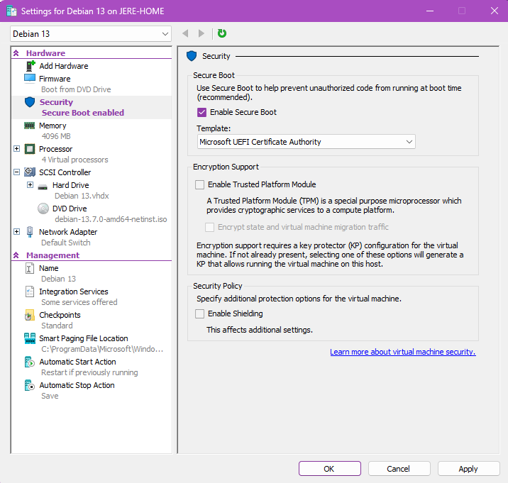
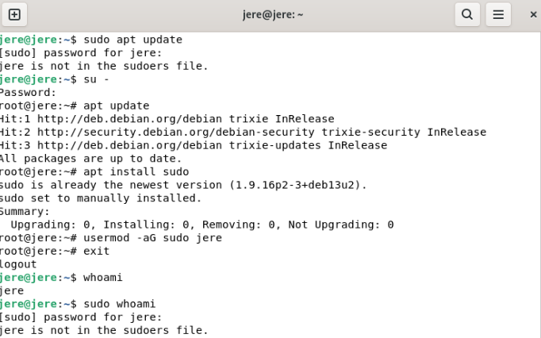
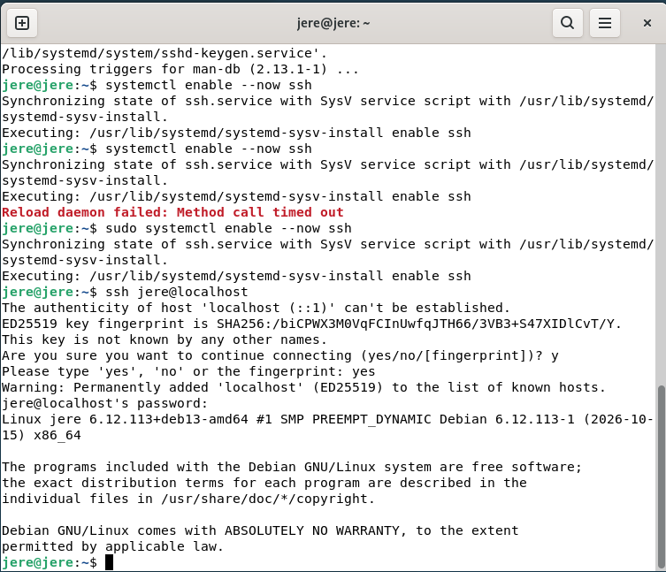
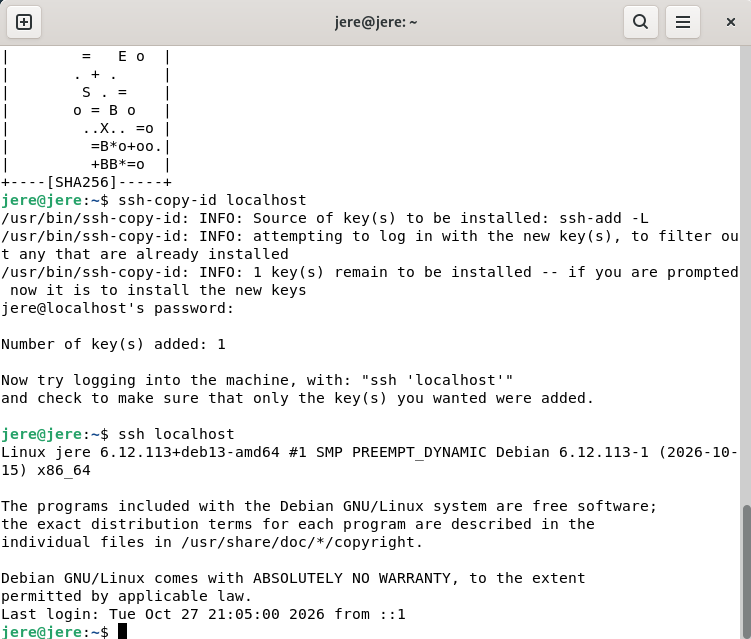
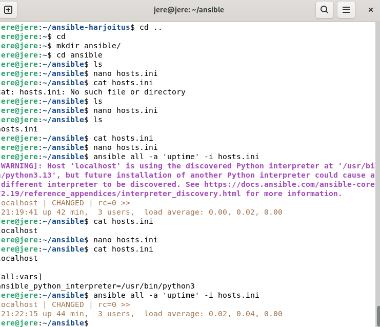
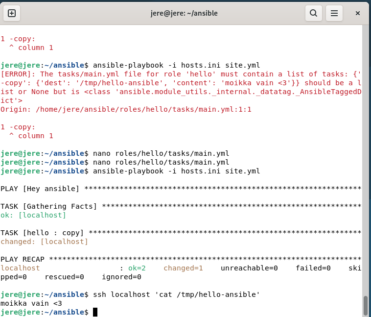

# h1 – Hei Ansiblen maailma

Tein harjoituksen Debian 13 -virtuaalikoneella Windowsin Hyper-V:ssä. Käyttäjätunnukseni oli `jere`. Testasin SSH:ta ja Ansiblea saman virtuaalikoneen sisällä osoitteella `localhost`.

## x) Lue ja tiivistä

### SSH public key - kirjaudu ilman salasanaa

- SSH:lla voi kirjautua toiselle koneelle. Palvelimelle asennetaan SSH-palvelu, ja yhteys voidaan harjoituksessa testata komennolla `ssh localhost`.
- `ssh-keygen` luo avainparin. Julkisen avaimen voi siirtää kohdekoneelle komennolla `ssh-copy-id localhost`. Yksityinen avain säilytetään omalla koneella.
- Avaimen lisäämisen jälkeen kirjautuminen onnistuu ilman käyttäjätilin salasanan kirjoittamista joka kerta.
- Harjoituksessa huomasin, että myös samalle koneelle kirjautuminen sopii yhteyden testaamiseen.

Lähde: [Tero Karvinen 2026: SSH public key – Login without password](https://terokarvinen.com/ssh-public-key-login-without-password/).

### Hello Ansible

- Ansiblella kuvataan haluttu lopputulos tekstitiedostoina. Se käyttää yhteyksiin SSH:ta, ja kohdekoneella tarvitaan myös Python.
- `hosts.ini` kertoo hallittavat koneet. Playbook määrittää ajettavat roolit. Roolin tehtävät kirjoitetaan esim. tiedostoon `roles/hello/tasks/main.yml`.
- Ohjeen hello-rooli kirjoittaa automaagisesti tiedoston `/tmp/`-hakemistoon. Tiedoston sisällön voi tarkistaa erikseen SSH:n kautta.
- Omassa harjoituksessani YAMLin välilyönnit aiheuttivat eniten ongelmia. Pieni kirjoitusvirhe esti koko ajon.

Lähde: [Tero Karvinen 2026: Hello Ansible](https://terokarvinen.com/hello-ansible/).

## a) Paikallista - Debian 13 Hyper-V:ssä

Asensin Debian 13:n paikalliseen virtuaalikoneeseen. Käytin Hyper-V:tä. Virtuaalikoneen asetukset olivat seuraavat:

| Asetus | Valinta |
| --- | --- |
| Virtuaalikoneen nimi | Debian 13 |
| Muisti | 4096 Mt |
| Virtuaalisuorittimet | 4 |
| Verkko | Default Switch |
| Asennuslevykuva | debian-13.7.0-amd64-netinst.iso |
| Secure Boot | Käytössä |
| Secure Boot -malli | Microsoft UEFI Certificate Authority |



*Kuva 1. Harjoituksessa käyttämäni virtuaalikoneen asetukset.*

Asennuksen jälkeen pääsin Debianin työpöydälle ja tein loput harjoituksesta terminaalissa. Koneen ja käyttäjän nimi näkyivät kehotteessa muodossa `jere@jere`.

### Sudo-oikeusongelma

Ensimmäinen ongelma tuli komennolla:

```bash
sudo apt update
```

Sain ilmoituksen `jere is not in the sudoers file.` Siirryin root-käyttäjäksi ja lisäsin käyttäjäni sudo-ryhmään:

```bash
su -
apt update
apt install sudo
usermod -aG sudo jere
exit
```

Sudo oli jo asennettu ja siksi ryhmään lisäämisen jälkeen kokeilin `whoami` ja `sudo whoami`, mutta samassa istunnossa sudo antoi vielä saman virheen.



*Kuva 2. Pelkkä root-istunnosta poistuminen ei vielä päivittänyt alkuperäisen istunnon ryhmiä.*

Ryhmän muutoksen käyttöönotto vaatii uuden kirjautumisistunnon. Seuraavassa asennuskuvassa `sudo apt install openssh-server` onnistuu.

## b) Sshecrets – SSH-palvelimen asennus ja testaus

Asensin SSH-palvelimen käsin:

```bash
sudo apt install openssh-server
```

Asennus latasi `openssh-server`-paketin ja sen riippuvuudet. Otin palvelun käyttöön ja käynnistin sen:

```bash
sudo systemctl enable --now ssh
```

Kokeilin komentoa ensin ilman sudoa. Yhdellä yrityksellä tuli ilmoitus `Reload daemon failed: Method call timed out`. Tämän jälkeen ajoin komennon sudolla ja kokeilin kirjautumista:

```bash
ssh jere@localhost
```

Ensimmäisellä yhteyskerralla SSH kysyi palvelimen avaimen hyväksymistä. Kirjoitin ensin `y`, mutta siihen piti vastata kokonaan `yes`. Sen jälkeen syötin käyttäjän salasanan ja pääsin sisään.



*Kuva 3. SSH-kirjautuminen onnistui salasanalla. Testi tehtiin Debianin sisällä localhostiin.*

Poistuin SSH-istunnosta komennolla:

```bash
exit
```

## c) Pubkey – kirjautuminen julkisella avaimella

Loin SSH-avainparin komennolla:

```bash
ssh-keygen
```

Yksityinen avain tallentui tiedostoon `/home/jere/.ssh/id_ed25519` ja julkinen avain tiedostoon `/home/jere/.ssh/id_ed25519.pub`.

Lisäsin julkisen avaimen saman koneen SSH-kirjautumista varten:

```bash
ssh-copy-id localhost
```

Tässä vaiheessa syötin vielä käyttäjän salasanan. Tulosteessa näkyi `Number of key(s) added: 1`. Sen jälkeen kokeilin uudelleen:

```bash
ssh localhost
```

Kirjautuminen onnistui nyt ilman salasanan kysymistä.



*Kuva 4. Avain lisättiin onnistuneesti, ja seuraava SSH-kirjautuminen pääsi suoraan sisään.*

## d) Hei Ansible – tiedoston luominen SSH:n yli

Käytin Ansiblea samalla Debian-koneella. Kuvissa näkyy toimiva Ansible-komento, mutta varsinaisesta Ansiblen asennuksesta ei ole kuvakaappausta. Debianin asennuskomento on `sudo apt install ansible`; sitä ei tässä esitetä kuvista varmistettuna työvaiheena.

### Kohdekone ja yhteyskokeilu

Loin kotihakemistoon `ansible`-hakemiston ja muokkasin tiedostoja Nanolla:

```bash
mkdir ansible/
cd ansible/
nano hosts.ini
```

Ensimmäisellä tarkistuksella `cat hosts.ini` ilmoitti, ettei tiedostoa löytynyt. Avasin tiedoston uudelleen ja tallensin sen. Lisäsin kohteeksi `localhost` ja kokeilin:

```bash
ansible all -a 'uptime' -i hosts.ini
```

Komento palautti koneen käynnissäoloajan ja tuloksen `CHANGED | rc=0`. Mukana tuli Python-tulkin automaattiseen valintaan liittyvä varoitus. Lisäsin tulkin asetuksen, jolloin `hosts.ini` oli seuraavanlainen:

```ini
localhost

[all:vars]
ansible_python_interpreter=/usr/bin/python3
```

Ajoin saman `uptime`-komennon uudelleen. Se onnistui, eikä Python-varoitusta enää tullut.



*Kuva 5. Molemmilla ajoilla paluuarvo oli nolla. Jälkimmäisestä tulosteesta Python-varoitus oli poistunut.*

### Playbook ja hello-rooli

Käytin playbookia `site.yml` ja roolin tehtävätiedostoa `roles/hello/tasks/main.yml`. Alla oleva playbook esittää kuvassa näkyvää ajoa vastaavan rakenteen

```yaml
- name: Hey ansible
  hosts: all
  roles:
    - hello
```

Roolin tehtävänä oli kirjoittaa tiedostoon `/tmp/hello-ansible` teksti `moikka vain <3`. Korjattu `roles/hello/tasks/main.yml`:

```yaml
- copy:
    dest: /tmp/hello-ansible
    content: "moikka vain <3\n"
```

### Tabulaattori ja kirjoitusvirhe

Käytin YAML-tiedoston sisennyksessä ensin tabulaattoria. Se ei kelvannut, joten vaihdoin sisennykset välilyönneiksi. Tässä tehtävässä `dest` ja `content` kuuluvat `copy`-kohdan alle, ja niiden edessä on neljä välilyöntiä.

Lisäksi olin kirjoittanut ensimmäisen rivin muodossa `-copy:`. Viivan ja sanan välistä puuttui välilyönti. Ansible ilmoitti, että roolin tehtävätiedoston pitää sisältää tehtävälista. Korjasin rivin muotoon `- copy:`.

### Onnistunut ajo ja tiedoston tarkistus

Korjausten jälkeen ajoin playbookin:

```bash
ansible-playbook -i hosts.ini site.yml
```

Ajosta tuli seuraava yhteenveto:

```text
localhost : ok=2 changed=1 unreachable=0 failed=0 skipped=0 rescued=0 ignored=0
```

Yksi tehtävä teki muutoksen, eikä ajo ilmoittanut epäonnistumisia. Tarkistin vielä tiedoston sisällön erikseen SSH:n kautta:

```bash
ssh localhost 'cat /tmp/hello-ansible'
```

Tulostus oli:

```text
moikka vain <3
```



*Kuva 6. Yläosassa näkyy `-copy`-virhe. Sen alapuolella näkyvät korjauksen jälkeinen onnistunut ajo ja tiedoston oikea sisältö.*


## Lopputulos

Sain Debianin toimimaan Hyper-V:ssä, SSH-kirjautumisen ensin salasanalla ja sen jälkeen avaimella sekä Ansiblen kirjoittamaan tiedoston. Tarkistin tiedoston sisällön SSH-yhteyden kautta.

Eniten aikaa meni pieniin virheisiin. Sudo-oikeudet eivät olleet aluksi käytössä, ja YAMLissa tabulaattori sekä puuttuva välilyönti pysäyttivät ajon. Muuten harjoitus sujui ihan hyvin. Tästä jäi erityisesti mieleen, että virheilmoituksessa näkyvä tiedosto ja rivinumero kannattaa katsoa tarkasti.

## Lähteet ja käytetyt apuvälineet

- [Tero Karvinen 2026: Palvelinten hallinta, h1 Hei Ansiblen maailma](https://terokarvinen.com/palvelinten-hallinta/#h1-hei-ansiblen-maailma). Tehtävänanto.
- [Tero Karvinen 2026: SSH public key – Login without password](https://terokarvinen.com/ssh-public-key-login-without-password/).
- [Tero Karvinen 2026: Hello Ansible](https://terokarvinen.com/hello-ansible/).
- Omat kuvakaappaukset harjoituksesta.
- Markdown muistinvirkistys (https://www.markdownguide.org/getting-started/)
- YAML syntaxi (https://www.yaml.info/learn/bestpractices.html#format)

