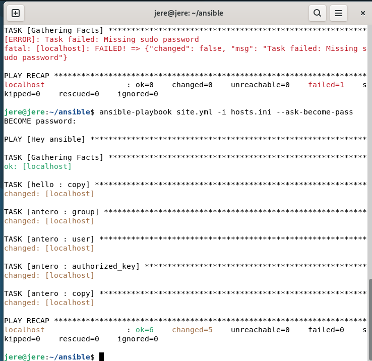
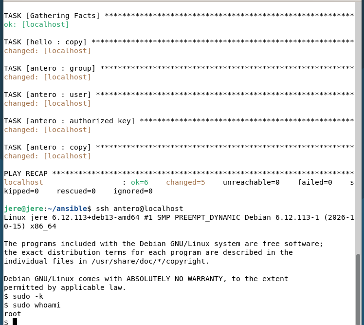
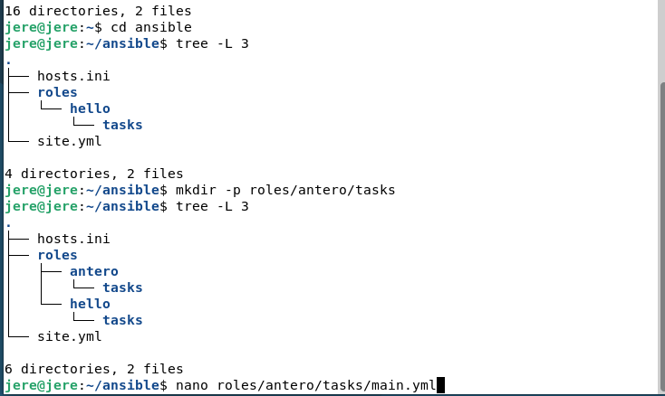
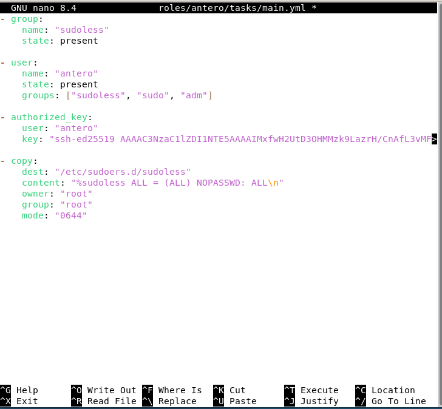
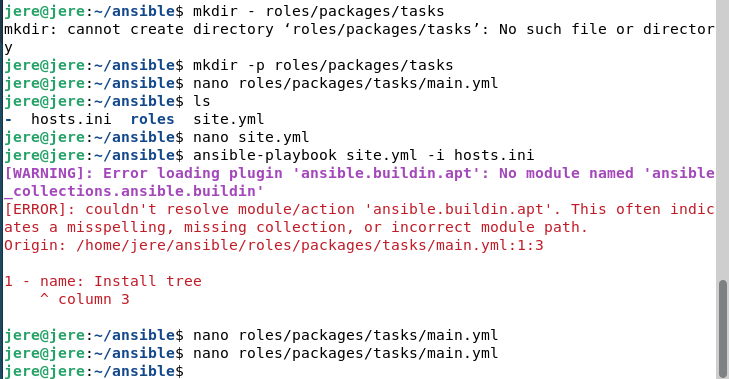
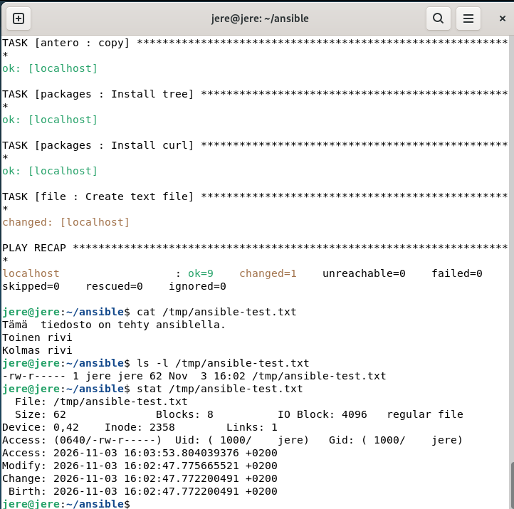
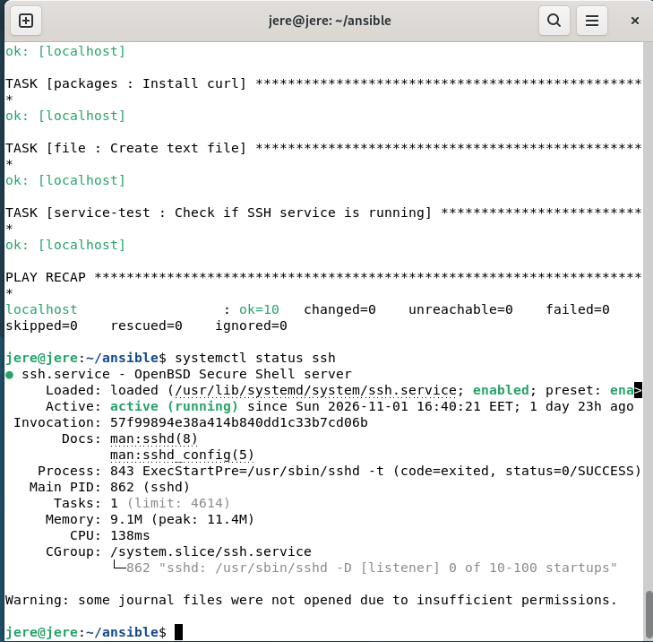

Tekijä Jere Pellinen 2026 [edit 3.11.2026 klo 17.58]

# x) Lue ja tiivistä

### Karvinen 2026: Sudo without password

- `sudo` voidaan määrittää toimimaan ilman salasanaa `NOPASSWD`-asetuksella.
- Käyttäjä voidaan lisätä omaan ryhmään, jolle annetaan sudo-oikeudet.
- `visudo` kannattaa käyttää sudoers-tiedostojen muokkaukseen.

**Oma huomio:** Kätevää automaatiossa, mutta antaa käyttäjälle paljon oikeuksia.

### Munroe 2006: xkcd 149 - Sandwich

- Hauska vitsi `sudo`-komennosta.
- Tavallinen pyyntö ei onnistu, mutta `sudo` muuttaa tilanteen.
- Linuxissa sudo mahdollistaa komentojen suorittamisen suuremmilla oikeuksilla.

**Oma huomio:** Lol, vänkä meemi.

### Karvinen 2026: Passwordless Sudo with Ansible

- Salasanaton sudo voidaan tehdä automaattisesti Ansiblen avulla.
- Ansible pystyy luoda käyttäjiä, ryhmiä, SSH-avaimia ja luoda tai muuttaa sudoers-asetuksia.
- Ajatus on tehdä asia ensin käsin ja automatisoida vasta sitten.

**Oma huomio:** Tässä näkyy hyvin Ansiblen hyöty kun hallitaan useita koneita.

## ansible-doc

`ansible-doc` näyttää Ansiblen moduulien ohjeet, valinnaty ja esimerkit komentorivillä.

### copy

- `content` - tiedoston sisältö
- `dest` - kohdepolku
- `src` - lähdetiedosto
- `owner`, `group`, `mode` - omistaja, ryhmä ja oikeudet

```yaml
- ansible.builtin.copy:
    src: test.txt
    dest: /tmp/test.txt
```

### apt

- `name` - paketin nimi
- `state` - esimerkiksi `present` tai `absent`
- `update_cache` - päivittää pakettilistan

```yaml
- ansible.builtin.apt:
    name: apache2
    state: present
```

### file

- `path` - tiedoston tai hakemiston polku
- `recurse` - tekee muutokset myös alihakemistoihin
- `src` - lähde esim. linkille
- `state` - esim. `directory`, `file` tai `absent`
- `owner`, `group`, `mode` - omistaja ja oikeudet

```yaml
- ansible.builtin.file:
    path: /tmp/test
    state: directory
```

### user

- `name` - käyttäjän nimi
- `create_home` - luodaan(ko) kotihakemisto
- `comment` - käyttäjän kuvaus tai kommentti
- `groups` - käyttäjän ryhmät
- `shell` - käytettävä shell
- `state` - esim. `present` tai `absent`
- `system` - järjestelmä(käyttäjä)

```yaml
- ansible.builtin.user:
    name: testi
    state: present
```

### authorized_key

- `user` - käyttäjä
- `key` - käyttäjän julkinen SSH-avain

```yaml
- ansible.posix.authorized_key:
    user: testi
    key: "{{ lookup('file', '~/.ssh/id_ed25519.pub') }}"
```

**Oma huomio:** `ansible-doc` on kätevä mm. koska eri moduulien ohjeet voi tarkistaa suoraan komentoriviltä. 


## a) Sudoless

Tein Ansiblea varten käyttäjän nimeltä `antero`. 'antero' voi käyttää sudoa ilman salasanaa. Ensimmäinen ajo ei onnistunut ilman (sudo)salasanaa. Ajoin playbookin uudelleen parametrilla:

```bash
ansible-playbook site.yml -i hosts.ini --ask-become-pass
```

Tämän jälkeen Ansible sai tarvittavat oikeudet ja käyttäjän sekä sudo-asetusten luonti onnistui.



*Ensimmäinen ajo epäonnistui puuttuvan sudo-salasanan vuoksi. `--ask-become-pass`-parametrilla ajo onnistui.*

Testasin lopuksi käyttäjän kirjautumalla sillä SSH:n kautta:

```bash
ssh antero@localhost
```

Sen jälkeen tyhjensin sudon mahdollisesti muistaman tunnistautumisen ja testasin käyttäjän oikeudet:

```bash
sudo -k
sudo whoami
```

Komento palautti `root`, eikä sudo kysynyt salasanaa.



*SSH-kirjautuminen ja salasanaton sudo toimivat.*


## b) Antero

Tein käyttäjän asetuksia varten oman Ansible-roolin:

```text
roles/antero/tasks/main.yml
```

Rooli:

- luo `sudoless`-ryhmän
- luo käyttäjän `antero`
- lisää käyttäjän tarvittaviin ryhmiin
- lisää julkisen SSH-avaimen `authorized_key`-moduulilla
- luo sudoers-asetuksen salasanatonta sudoa varten



*Ansible-projektin rooli-rakenne tässä vaiheessa.*



*Antero-roolissa luodaan käyttäjä, ryhmä, SSH-avain ja sudoers-asetus.*

Huomasin myös tehtävän tehdessä, että terminaalissa toimiva "autotäyttö" tabilla toimii paremmin kuin olin tiennyt. TÄmä nopeutti tehtävän tekoa huomattavasti ja vähensi kirjoitusvirheitä.


## c) Package

Tein erillisen `packages`-roolin ja asensin sillä kaksi pakettia:
e
- `tree`
- `curl`

Käytin asentamiseen Ansiblen `apt`-moduulia.

Aluksi kirjoitin moduulin nimen vahingossa väärin:

```text
ansible.buildin.apt
```

Ansible ilmoitti, ettei kyseistä moduulia löydy.



*Ensimmäinen ajo epäonnistui, koska kirjoitin `builtin` vahingossa `buildin`.*

Korjasin moduulin oikeaan muotoon:

```yaml
- name: Install tree
  ansible.builtin.apt:
    name: tree
    state: present

- name: Install curl
  ansible.builtin.apt:
    name: curl
    state: present
```

Tämän jälkeen playbookin ajo meni onnistuneesti läpi ja paketit olivat asennettuina.

## d) File

Tein `file`-roolin, jolla Ansible kirjoittaa useamman rivin sisältävän tiedoston:

```text
/tmp/ansible-test.txt
```

Tiedostolle määritin samalla:

```yaml
owner: "jere"
group: "jere"
mode: "0640"
```

Tiedoston oikeudet oktaalimuodossa ovat:

```text
0640
```

Symbolisessa muodossa ne ovat:

```text
-rw-r-----
```

Oikeudet tarkoittavat:

- **Omistaja `jere`: `rw-`** - saa lukea ja kirjoittaa tiedostoa.
- **Ryhmä `jere`: `r--`** - saa lukea tiedostoa, mutta ei kirjoittaa siihen.
- **Muut käyttäjät: `---`** - eivät saa lukea, kirjoittaa tai suorittaa tiedostoa.

Eli
- **r** - lukuoikeudet
- **w** - kirjoitusoikeudet
- **x** - suoritusoikeudet

ja
- **3 ensimmäistä** - omistajan oikeudet
- **3 kesimmäistä** - ryhmän oikeudet
- **3 viimeistä** - muiden käyttäjien oikeudet

Symbolisen muodon ensimmäinen `-` kertoo, että kyseessä on tavallinen tiedosto.

Tarkistin lopputuloksen komennoilla:

```bash
cat /tmp/ansible-test.txt
ls -l /tmp/ansible-test.txt
stat /tmp/ansible-test.txt
```



*Kuvassa näkyvät tiedoston sisältö, omistaja, ryhmä sekä oikeudet `0640/-rw-r-----`.*


## e) Jotain muuta

Valitsin uutena Ansiblen ominaisuutena `service`-moduulin. Tein sille oma `service-test`-roolin.

Määritin SSH-palvelun käynnissä olevaksi ja samalla käynnistymään automaattisesti:

```yaml
- name: Check if SSH service is running
  ansible.builtin.service:
    name: ssh
    state: started
    enabled: true
```

Elikkä:

- `name: ssh` tarkoittaa hallittavaa palvelua
- `state: started` varmistaa, että palvelu on käynnissä
- `enabled: true` määrittää sen käynnistymään myös järjestelmän käynnistyessä

Tarkistin lopuksi tilanteen komennolla:

```bash
systemctl status ssh
```

SSH-palvelun tilaksi tuli:

```text
active (running)
```



*Playbook onnistui ja SSH-palvelu oli käynnissä.*


## Tekoälyn käyttö

Pyysin apua tekoälyltä Markdownin kanssa (prompt: "muunna tämä markdowniksi" ja uppasin alkuperäisen tekstitiedoston)

## Lähteet [Edit 3.11.2027 klo 17.37]
https://terokarvinen.com/palvelinten-hallinta
https://terokarvinen.com/passwordless-sudo/
https://xkcd.com/149/

