# h3 Demoni

- 9.11.2026 tekijä **Jere Pellinen**
- **Kurssi:** Palvelinten hallinta ICI001AS3A-3017-ph17
- **Oppilaitos:** Haaga-Helia ammattikorkeakoulu
- **Opettaja:** Tero Karvinen
- **Ympäristö:** Debian 13, Hyper-V, paikallinen virtuaalikone

## x) Lue ja tiivistä

### Karvinen 2026: Apache installed with Ansible - quick notes

- Ansiblea voidaan käyttää Apachen, ja sen asetusten, määrittelyyn
- `package-file-service` on ansiblen ominaisuus. Tällä voidaan asentaa ohjelmia, käynnistää palveluja sekä muuttaa asetuksia ohjelmaan.
- HTML-sivu voidaan laittaa kotihakemistoon, jolloin sitä voidaan muokata ilman sudoa
- Jos asetukset muuttuvat niin voidaan määrittää niin, että handleri käynnistää tarvittavan palvelun uudelleen

**Oma kysymys:** Pitääkö palvelu käynnistää uudelleen, jos muokkaan HTML-tiedostoa?

-Vastaus omaan kysymykseeni: Ei tarvitse.

### Ansible Community Documentation: Handlers

- Handler suoritetaan vain kun tapahtuu jokin etukäteen määritetty muutos
- Jos asetukset eivät muutu, palvelua ei tarvitse käynnistää uudelleen.
- `notify`:ssä määritetään mikä handler suoritetaan
- Handler suoritetaan vain kun jokin etukäteen määritetty muutos tapahtuu

**Oma huomio:** Kuulostaa hyvältä. Ei tarvitse käynnistellä palveluja uudestaan.

### ansible-doc service

`service`-moduulilla hallitaan Linuxin palveluita, esim. Apachea ja Nginxiä.

- `enabled` =käynnistyykö palvelu automaattisesti koneen käynnistyessä.
- `name` =palvelun nimi jota hallitaan.
- `state` =haluttu tila, esim. `started`, `stopped` tai `restarted`.

Esim.:

```yaml
- name: Start Apache
  ansible.builtin.service:
    name: apache2
    state: started
    enabled: true
```

Yllä oleva esimerkki käynnistää apachen ja pitää sen päällä.

**Mitä tuli mieleen?** `started`vs `restarted`

Vastaus omaan kysymykseen: 
- 'started': käynnistää palvelun mikäli se ei ole jo käynnissä
- 'restarted': käynnistää palvelun uudelleen vaikka se olisi jo käynnissä. Jos ei palvelu ole ennestään käynnissä, se käynnistetään.


## a) Apassi

### Apachen asennus

Tein tehtävän samalla Debian 13 -virtuaalikoneella mitä käytin aiemmassa tehtävässä. Koneeseen oli aiemmin asennettu Caddy, joka käytti porttia 80. 

Tarkistin tilanteen komennolla:

```bash
sudo ss -ltnp '( sport = :80 )'
```

Tulosteessa näkyi `caddy` joten pysäytin sen:

```bash
sudo systemctl stop caddy
```


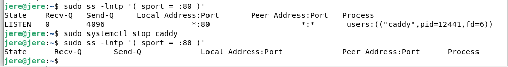

*Portti 80 oli Caddyn käytössä*

Sitten asensin Apachen:

```bash
sudo apt update
sudo apt install apache2
```

Tarkistin palvelun:

```bash
systemctl status apache2
```

Palvelun tilana näkyi `active (running)`.

Testaus:

```bash
curl -I http://localhost
```

Apache vastasi `HTTP/1.1 200 OK`, ja selaimessa näkyi Debianin Apachen oletussivu.

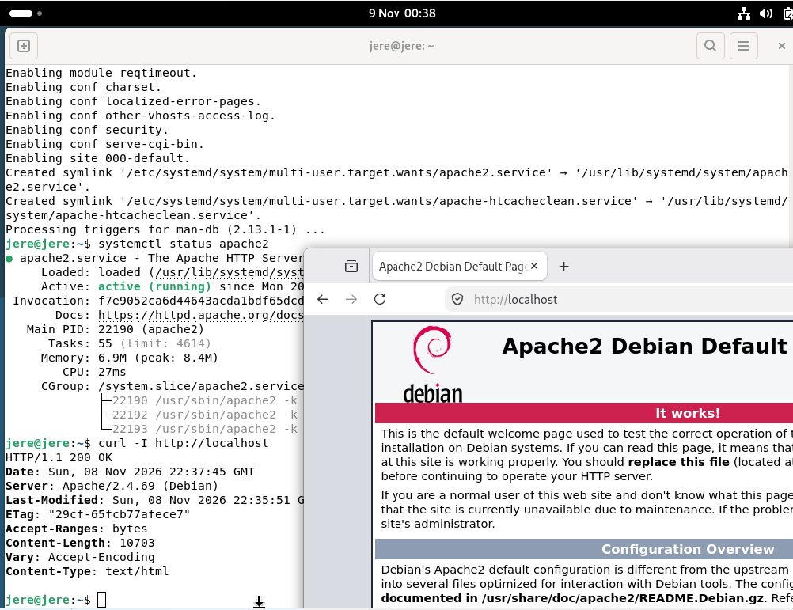

*Apache oli asennettu ja oletussivu näkyi localhostissa.*

### Oman sivun tekeminen

Tein sivuille oman hakemiston kotihakemistoon:

```bash
mkdir -p ~/apache-site
nano ~/apache-site/index.html
```

Luodessani HTML-tiedostoa Nanolla en käyttänyt sudoa.

Sitten:

```bash
sudo nano /etc/apache2/sites-available/jere.conf
```

Asetukset:

```apache
<VirtualHost *:80>
    ServerName localhost
    DocumentRoot /home/jere/apache-site

    <Directory /home/jere/apache-site>
        Require all granted
    </Directory>
</VirtualHost>
```

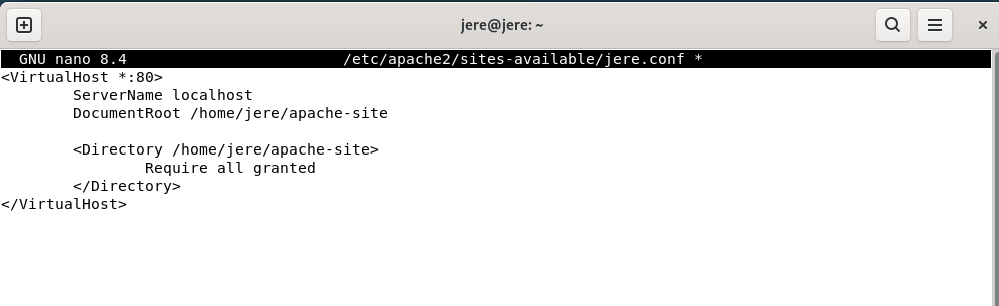
*Asetukset*

Asetusten varmistus

```bash
sudo apache2ctl configtest
```

Kone vastasi `Syntax OK`. 

Lataa apachen asetukset uudelleen

```bash
sudo systemctl reload apache2
```
---
### Side quest: Apachen a2-komennot

Huomasin, että Debianin Apachen hallintakomennoissa on selkeä nimeämislogiikka:

**`a2` + `en/dis` + `mod/site/conf`**

- `a2` = Apache 2 | ensimmäinen osa
- `en` = Enable (ota käyttöön) | toinen osa
- `dis` = Disable (poista käytöstä) | toinen osa
- `mod` = Module (moduuli) | kolmas osa
- `site` = Site (sivusto) | kolmas osa
- `conf` = Configuration (asetukset) | kolmas osa
- on olemassa myös komento `a2query`

1^2^3=6 joten on olemassa kuusi komentoa.

---
Laitoin sivun päälle

```bash
sudo a2ensite jere.conf
sudo a2dissite 000-default.conf
sudo systemctl reload apache2
```

 `HTTP/1.1 200 OK`

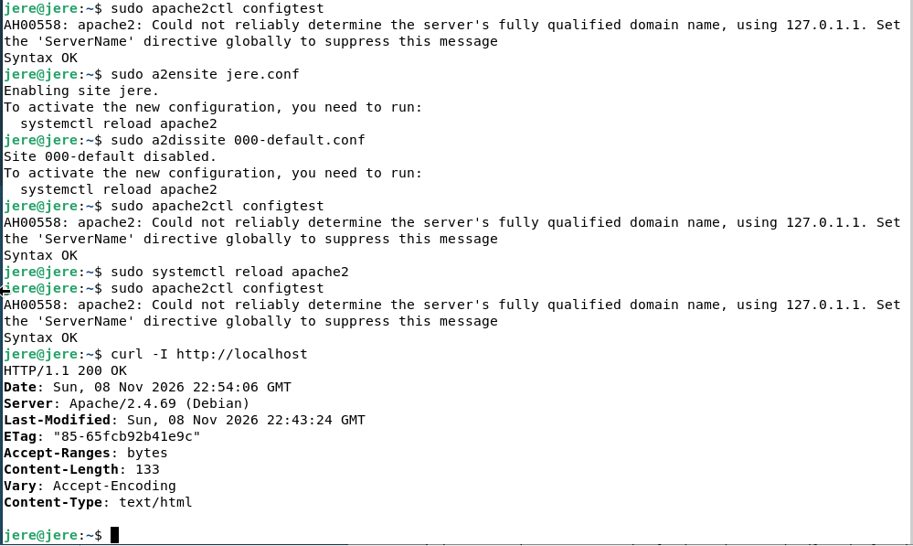

*Apache vastasi.*

Ääkköset eivät näkyneet oikein. Lisäsin tiedostoon rivin:

```html
<meta charset="UTF-8">
```


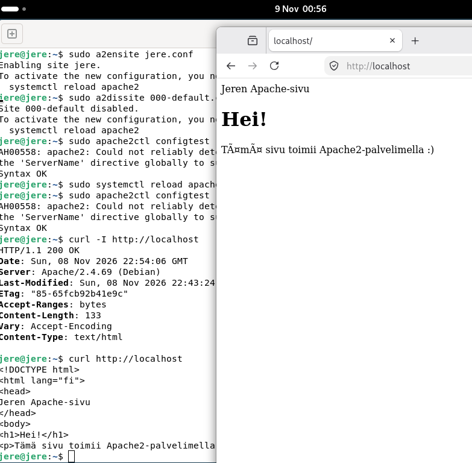

*Unohdin laittaa UTF-8 merkistön käyttöön.*

Muistelen opettaja Tero Karvisen sanoneen luennolla, että kannattaa käyttää pelkkää tekstiä ilman HTML:ää. Tässä lienee yksi syy.

Apache toimii ja omat sivut näkyvät selaimessa.

Tiedosto luotiin ilman sudoa.

## b) Moottorix

### Nginxin asennus

Ensin pysäytin Apachen...: ja tarkistin että portti on vapaa, koska molemmat käyttävät porttia 80 (varattu http:lle):

```bash
sudo systemctl stop apache2
```

...sitten tarkistin, että portti on vapaa (Apache ja Nginx käyttävät molemmat porttia 80, tämä ei ole ok):

```bash
sudo ss -ltnp '( sport = :80 )'
```

Kun portti oli vapaa, asensin Nginxin:

```bash
sudo apt update
sudo apt install nginx
```

Varmistin onko se päällä:

```bash
systemctl status nginx
```

Nginxin oli `active (running)` ja `enabled`.

Tarkistus:

```bash
curl -I http://localhost
```

Tulos:

```text
HTTP/1.1 200 OK
Server: nginx
```

Eli Nginx oli päällä.

### Oma sivu

Tein Nginxille oman hakemiston ja HTML-sivun:

```bash
mkdir -p ~/nginx-site
nano ~/nginx-site/index.html
```

Eli tiedosto sijaitsee täällä:

```text
/home/jere/nginx-site/index.html
```

Omistajana ja ryhmänä näkyi `jere`, hoten sivua pystyi muokkaamaan ilman sudoa.

Muutin Nginxin asetustiedostoa...:

```bash
sudo nano /etc/nginx/sites-available/default
```

...osoittamaan hakemistoon:

```nginx
root /home/jere/nginx-site;
```

Tarkistin vileä asetukset:

```bash
sudo nginx -t
```

Varmistus:

```text
syntax is ok
test is successful
```

Käynnistin Nginx:n uudelleen jotta asetukset päivittyvät:

```bash
sudo systemctl reload nginx
```

### Testaus

Testasin localhostin:

```bash
curl -i http://localhost
```

Tulos oli `HTTP/1.1 200 OK`, ja sisältö oikean näköinen.

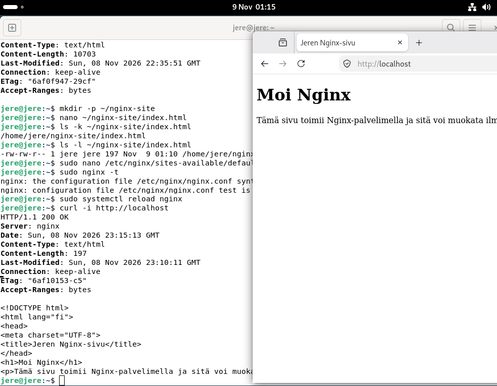

*Itse tehty Nginx-sivu näkyy selaimessa ja curl palauttaa oikean HTML-sisällön.*

**Lopputulos:** Nginx asennettiin käsin, sivu näkyy palvelimen etusivulla ja HTML-tiedostoa voi muokata ilman sudoa.

## c) Automoottorix

### Ansiblen automatisointi Nginx:ää käyttäen

Kopioin aikaisemmin testaamani Nginxin asetustiedoston roolin `files`-hakemistoon:

```bash
cp /etc/nginx/sites-available/default roles/nginx/files/default
```

Näin Ansible käyttää samaa asetusta, jonka jo tiesin toimivan.

### Rooli

Loin tiedoston:

```text
roles/nginx/tasks/main.yml
```

Sisältö:

```yaml
- name: Install Nginx
  ansible.builtin.apt:
    name: nginx
    state: present

- name: Configure Nginx
  ansible.builtin.copy:
    src: default
    dest: /etc/nginx/sites-available/default
    owner: root
    group: root
    mode: '0644'
  notify: restart nginx

- name: Ensure Nginx is running
  ansible.builtin.service:
    name: nginx
    state: started
    enabled: true
```

Käytin siis `package-file-service`josta maininta jo alussa tehtävä x:ssä (Lähde sivun lopussa)


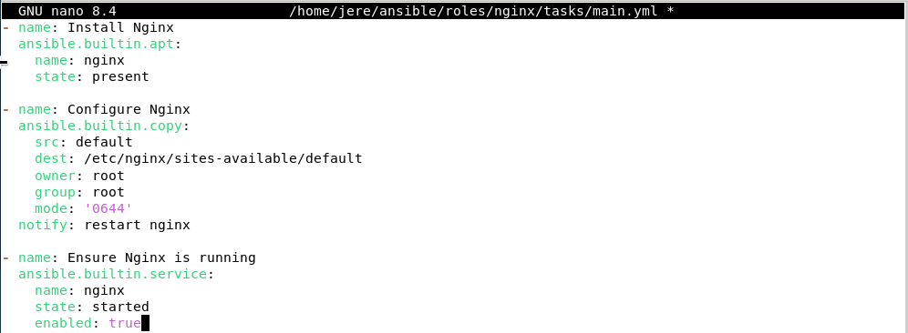

*Nginx main.yml.*

### Toinen onglema

Sulkiessani ja tallentaessani `main.yml` nano sanoi:

```text
Error writing ... No such file or directory
```

Olin yrittänyt kirjoittaa tiedoston hakemistoon, jota ei vielä ollut olemassa.

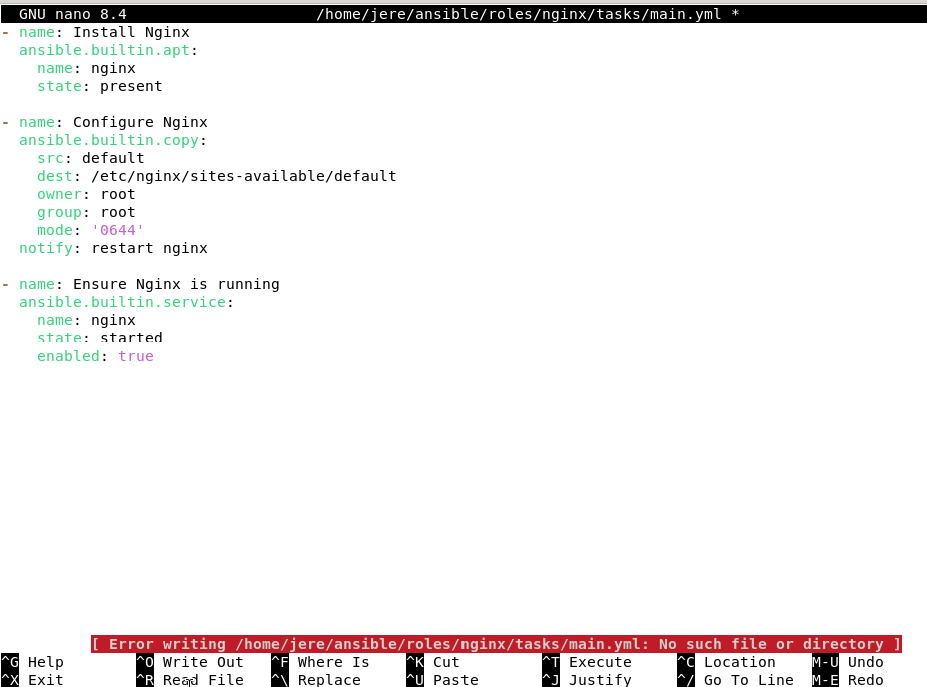

*Tallennus epäonnistui, koska hakemisto puuttui.*

Loin toisessa ikkunassa hakemistot:

```bash
mkdir -p ~/ansible/roles/nginx/tasks
mkdir -p ~/ansible/roles/nginx/handlers
mkdir -p ~/ansible/roles/nginx/files
```

Sen jälkeen tallennus onnistui. Nano oli edelleen auki, eli kirjoittamani teksti ei kadonnut.

### Handler

Tein handlerin tiedostoon:

```text
roles/nginx/handlers/main.yml
```

Sisältö:

```yaml
- name: restart nginx
  ansible.builtin.service:
    name: nginx
    state: restarted
```

Handler käynnistää Nginxin uudelleen vain silloin, kun `notify` kutsuu sitä.

Lisäsin `nginx`-roolin `site.yml`-tiedostoon.

Syntaxin tarkastuksen voi tehdä seuraavalla komennolla:

```bash
ansible-playbook -i hosts.ini site.yml --syntax-check
```

### Ansible käyntiin

Ajoin playbookin:

```bash
ansible-playbook -i hosts.ini site.yml
```

Kaikki tehtävät menivät läpi:

```text
ok=13
changed=0
failed=0
```

### Handlerin testaus

Halusin vielä kokeilla, toimiiko tekemäni handler ihan oikeasti.

Lisäsin Nginxin asetustiedostoon `echo`:lla:

```bash
echo '# Handler test' >> roles/nginx/files/default
```
Huomion arvoista ehkä on, että se hyväksyi myös (ei välilyöntiä `>>` -merkkien jälkeen.)

```bash
echo '# Handler test' >>roles/nginx/files/default
```
Ajoin playbookin uudelleen.

Ansible huomasi muuttuneen tiedoston:

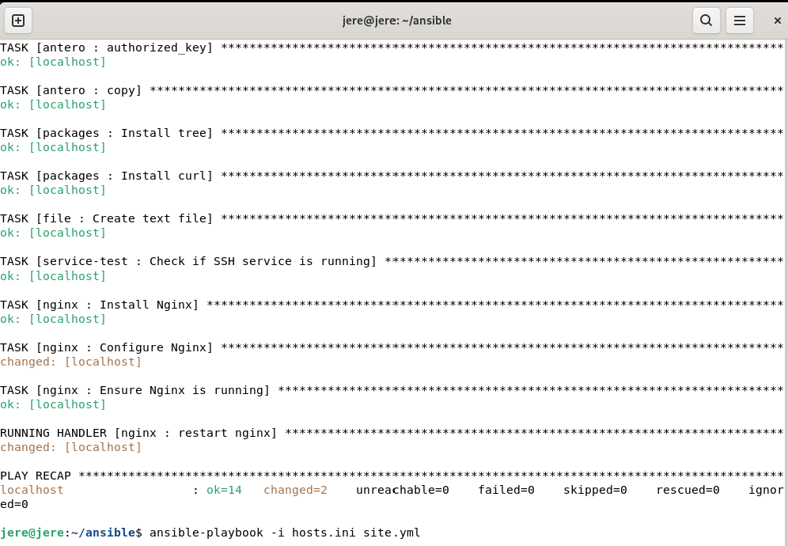

*Ansible huomasi että on tullut muutoksia ja ajoi siksi nginx handlerin*

Handler toimi siis oikein.

### Idempotenssin testaus

Ajoin saman playbookin vielä kerran muuttamatta mitään.

```bash
ansible-playbook -i hosts.ini site.yml
```

Handler ei käynnistynyt, koska asetustiedosto ei ollut muuttunut.

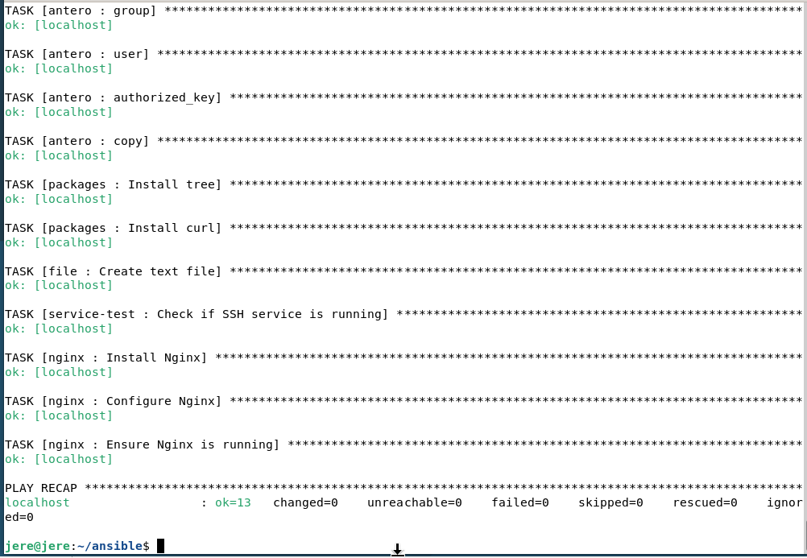

*Toisella ajolla kaikki oli halutussa tilassa joten Ansible ei tehnyt muutoksia.*

### Viimeinen varmistus

Tarkistin lopuksi vielä Nginxin toiminnan:

```bash
curl -I http://localhost
curl http://localhost
```

Vastaus: `HTTP/1.1 200 OK` ja juuri tekemäni html sisältö.

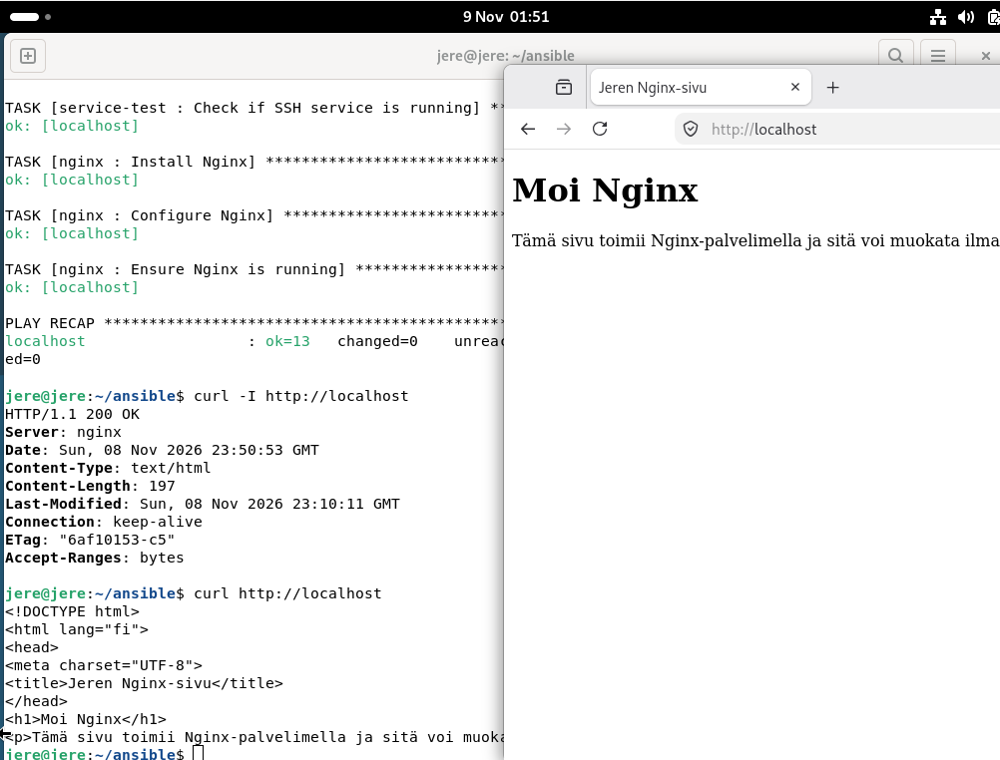

*Lopullisessa testissä näkyvät onnistunut Ansible-ajo, HTTP-vastaus ja oma sivu selaimessa.*

- Nginxin asennus, asetustiedosto ja palvelun käynnissäolo on määritetty Ansiblella. Handler ja idempotenssi toimivat.

- On hyvä huomata että Nginx oli jo asennettu jo ennen automaatiota.

## Lopputulos ja omaa pohdintaa


Oli hienoa huomata kuinka hyvin apache ja nginx toimivat samalla koneella samaa aikaa noin hyvin.

Nginx asentaminen ja sen automatisointi ei ollut vaikeaa. Kirjoitusvirheet on hyvä tarkastaa omalla kohdalla vähintään kaksi kertaa, koska tuntuu, että se on isoin ongelmani. 

Minusta oli kiva tutkia myös a2 toimintaa.

Muutamia huomioita:

- Kun haluaa varmistaa Idempotenssin niin yksi keino on muuttaa jotakin asetusta ja katsoa onko jokin muuttunut
- Älä pidä kahta web-palvelinta samanaikaisesti päällä koska portit on varattu http-liikenteelle (portti 80) tai https-liikenteelle (portti 443). On siis ongelmallista, jos kaksi softaa koittaa vastata samaan aikaan.
- curl -I http://localhost on käytännöllinen koska se näyttää enemmän tietoja oletuksena kuin mitä selaimen kautta saa.
- Handler käynnistää palvelut automaattisesti uudelleen tarvittaessa.
- Pienetkin asiat, kuten puuttuva hakemisto tai HTML:n merkistöt jne., voivat viedä ylimääräsistä aikaa. Eli kannattaa olla tarkkana kun kirjoittaa.
- Paikallinen virtuaalikone on mainio paikka harjoitteluun
- "händler" olisi suomalaiseen suuhun sopivampi nimi

Tehtävä oli hyvä jatko edelliseen tehtävään. Kiva nähdä että sai automatisoinnin toimimaan.


### D-Bonustehtävä työn alla

## Lähteet

- [Karvinen 2026: Palvelinten hallinta - h3 Demoni](https://terokarvinen.com/palvelinten-hallinta/) - Tehtävänanto ja ohjeet.
- [Ansible Community Documentation: Handlers - running operations on change](https://docs.ansible.com/projects/ansible/latest/playbook_guide/playbooks_handlers.html) - x-kohdan lukumateriaali ja handlerien toiminta.
- `ansible-doc service` - Ansiblen paikallinen dokumentaatio, x-kohdan optiot ja esimerkki.
- [Debian: Apache2 Manual Pages (Debian 13 Trixie)](https://manpages.debian.org/trixie/apache2/index.html) - Apachen sivustojen, moduulien ja asetusten käyttöönottoon ja käytöstä poistamiseen tarkoitetut komennot (`a2ensite`, `a2dissite`, `a2enmod`, `a2dismod`, `a2enconf`, `a2disconf`).
- [Ansible Community Documentation: ansible.builtin.service](https://docs.ansible.com/projects/ansible/latest/collections/ansible/builtin/service_module.html) - `started`- ja `restarted`-asetusten toiminta.
- [Karvinen 2026: Apache installed with Ansible - quick notes](https://terokarvinen.com/apache-ansible/) - Handlerin käyttö
- Omat komennot, testitulokset ja kuvakaappaukset Debian-ympäristöstä.
- ChatGPT, 9.11.2026. Käytetty tehtävän muuntamiseen MD-muotoon käskyllä "muunna tämä Markdowniksi. Älä koske sisältöön tai kommentoi sitä. Kuvat ovat samannimisiä kuin tekstissä ja sijaitsevat kansiossa images"

## Lisenssi ja pohjamateriaali

- Tätä dokumenttia saa kopioida ja muokata GNU General Public License (versio 2 tai uudempi) mukaisesti. [GNU GPL](http://www.gnu.org/licenses/gpl.html).
- Pohjana Tero Karvisen Linux-kurssi, [Palvelinten Hallinta](https://terokarvinen.com/palvelinten-hallinta/).
