# h4 Pizza Fantasia

## Ympäristö

- **Päivämäärä:** 13.11.2026
- **Tekijä:** Jere Pellinen
- **Kurssi:** Palvelinten hallinta ICI001AS3A-3017-ph17
- **Oppilaitos:** Haaga-Helia ammattikorkeakoulu
- **Opettaja:** Tero Karvinen
- **Ympäristö:** Debian 13, Hyper-V, paikallinen virtuaalikone

## x) Lue ja tiivistä

### 4.12.1 Size and Complexity of Some DSLs, s. 112

- DSL:t (Domain-Specific Language) voivat olla erittäin monimutkaisia ja isoja.
- Karvinen analysoi Saltin DSL:ää ja keräsi siitä dataa versiolla 2017.7.4 ”Nitrogen”.
- Tutkitussa Saltin versiossa oli 510 tilafunktiota. Niiden dokumentaatiossa oli yli 20 000 riviä ja yli 75 000 sanaa.
- Tutkimuksen mukaan Puppetissa oli 113 funktiota suoraan asennuksen jälkeen.
- Puppet käyttää omia käsitteitään, kuten virtuaalisia resursseja.

**Ajatuksia:** Pohdin tässä vaiheessa, mitä Karvinen tarkoittaa virtuaalisten resurssien käsitteellä ja miten se toimii käytännössä.

### 4.12.2 Use of DSL Functions in Case Configuration, s. 112–115

- Aineistona olivat Puppet-kielellä kirjoitetut tuotantokonfiguraatiot: United States Government Configuration Baseline (NIST, 2016) ja Mozilla Release Engineering Puppet Manifests (Mitchell et al., 2020).
- Mozillassa 12 toimintoa ja rakennetta kattoivat 87 % lasketuista esiintymistä.
- Tutkimuksessa tarkasteltiin koodia, ei komentojen suorituskertoja.
- Vaikka konfiguraationhallinnan (CM, Configuration Management) työkalut tarjoavat laajan kirjon toimintoja, tutkituissa aineistoissa vain muutamaa käytettiin laajasti.

**Ajatuksia:** Mielenkiintoista. Onko vain niin monta eri tapaa tehdä samat asiat?

### 4.12.3.1 Dependencies Between Main Functions, s. 115–117

- Kappaleessa käsitellään eri funktioiden riippuvuussuhteita. Tässä tapauksessa funktioilla tarkoitetaan resursseja.
- Confterossa, Tero Karvisen omassa konfiguraationhallintajärjestelmässä, tavoitteena on, ettei käyttäjän tarvitse ymmärtää syvällisesti funktioiden riippuvuuksien hallintaa.
- Järjestelmän tulisi olla idempotentti: muutoksia tehdään vain, jos järjestelmä ei ole jo oikeassa tilassa.
- `exec` ja tiedostojen hallinta (`file`, `directory`, `symlink`) ovat pohjimmaiset rakennuspalikat. Niiden varaan voidaan rakentaa esimerkiksi pakettien, palveluiden ja käyttäjien hallinta sekä edelleen korkeamman tason toimintoja.

**Ajatuksia:** Tulee mieleen makrot – ihmistä helpottamaan ja nopeuttamaan rutiininomaisia töitä.

## a) Räpylä

Valitsin asennettavaksi Eclipse Mosquitton. Se on kevyt, avoimen lähdekoodin viestinvälittäjä (message broker). Mosquitto käyttää MQTT-protokollaa (Eclipse Foundation) ja mahdollistaa IoT-laitteiden ja muiden laitteiden välisen kommunikoinnin.

Aloitin asentamisen:

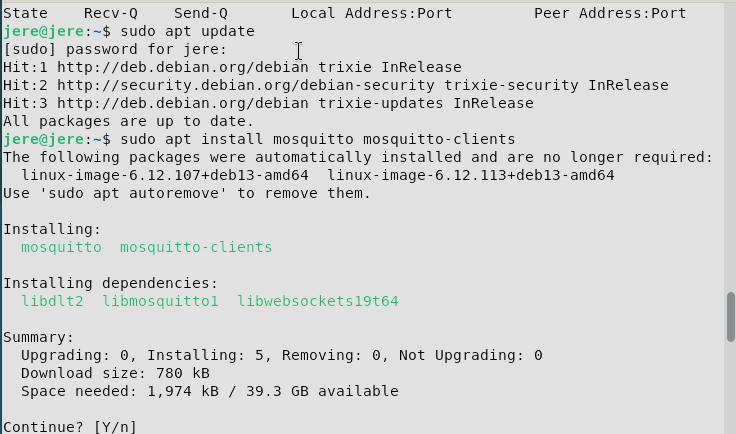

Tässä vaiheessa kannattaa testata, ovatko portit 1883, 1884 ja 1885 vapaina:

```bash
sudo ss -ltnp '( sport = :1883 or sport = :1884 or sport = :1885 )'
```

Muokkasin tämän jälkeen konfiguraatiotiedostoa:

```bash
sudo nano /etc/mosquitto/conf.d/h4.conf
```
Asetusten selitykset: [mosquitto.conf(5), listener ja allow_anonymous](https://manpages.debian.org/trixie/mosquitto/mosquitto.conf.5.en.html).

Tarkoituksena oli lisätä sinne kaksi riviä:

```text
listener 1884 127.0.0.1
allow_anonymous true
```

Koitin käynnistää palvelua uudestaan, mutta tuli virheilmoitus.

Aloitin vian selvittämisen komennolla, joka näyttää palvelun tilan:

```bash
systemctl status mosquitto
```

Tämän jälkeen tarkistin luomani konfiguraatiotiedoston sisällön:

```bash
sudo cat -n /etc/mosquitto/conf.d/h4.conf
```

Sitten tulostin lokit:

```bash
sudo tail -n 40 /var/log/mosquitto/mosquitto.log
```

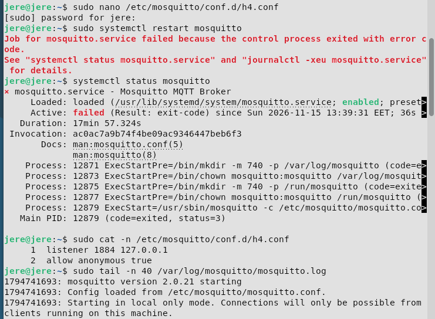

*Virheilmoitus sekä vianselvitystä.*

Suoritettuani seuraavan komennon huomasin, että minulla oli kirjoitusvirhe `h4.conf`-tiedostossa:

```bash
sudo journalctl -u mosquitto -n 20 --no-pager
```

Avasin tiedoston uudelleen:

```bash
sudo nano /etc/mosquitto/conf.d/h4.conf
```

Korjasin toisen rivin kirjoitusvirheen: `allow anonymous true` → `allow_anonymous true`.

Tämän jälkeen Mosquitto käynnistyi uudelleen ilman ongelmia.

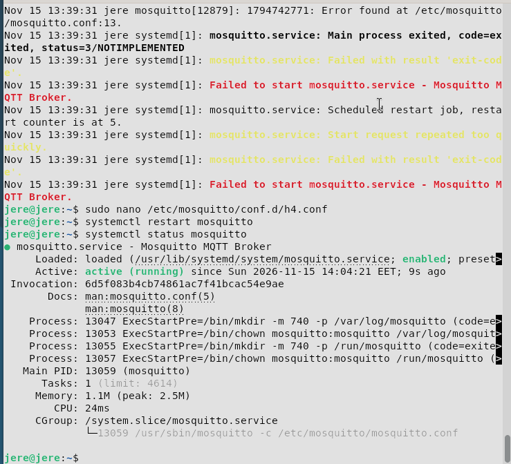

*Mosquitto käynnistyi uudelleen.*

Seuraavaksi testasin, toimivatko MQTT-viestit terminaalin kautta. Avasin kaksi terminaalia rinnakkain. Vasemmassa oli vastaanottaja ja oikeassa lähettäjä.

Vastaanottajan ikkunaan:

```bash
mosquitto_sub -h 127.0.0.1 -p 1884 -t 'h4/pizza' -v -C 1
```

Lähettäjän ikkunaan:

```bash
mosquitto_pub -h 127.0.0.1 -p 1884 -t 'h4/pizza' -m 'Jeren fantasiapizza: viestit toimivat portissa 1884'
```

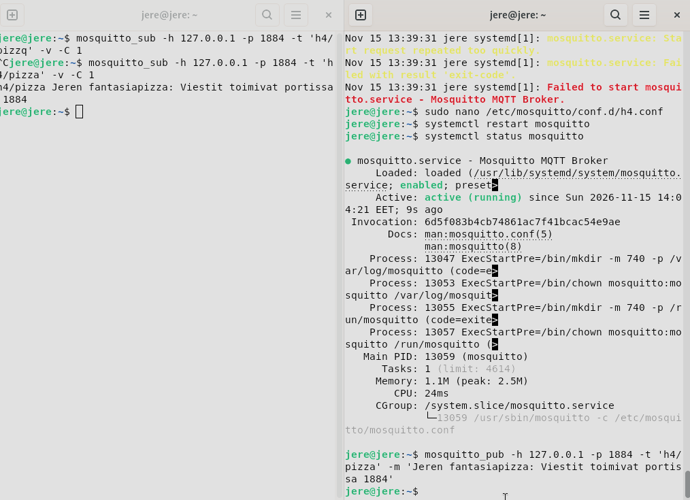

*Viestit toimivat.*

## b) Automaatti

### Uudelleenasennus

Poistin Mosquitton, jotta voin asentaa sen Ansiblella:

```bash
sudo apt purge mosquitto
```

Asennusohjelma huomautti, että luomaani konfiguraatiotiedostoa ei poistettu, joten suoritin:

```bash
sudo rm -f /etc/mosquitto/conf.d/h4.conf
```


### Ansible-roolin luominen

Loin tehtävälle oman hakemiston ja Mosquitto-roolin kansiot:

```bash
mkdir -p ~/ansible/roles/mosquitto/{tasks,handlers,templates,defaults}
```

Kirjoitin `~/ansible/h4.yml`-tiedostoon rivit:

```yaml
- name: Manage local Mosquitto
  hosts: localhost
  connection: local
  become: true
  roles:
    - mosquitto
```

Testasin paikallisen yhteyden:

```bash
ansible -i hosts.ini localhost -c local -m ansible.builtin.ping
```

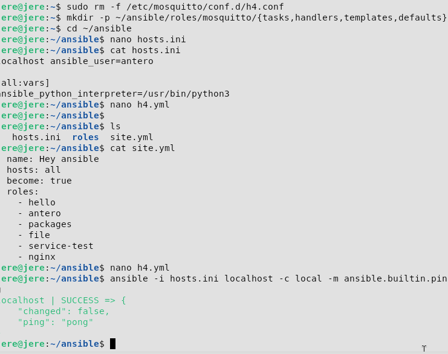

*Paikallinen yhteys toimii.*

Tämän jälkeen loin oletusmuuttujan Mosquitto-roolin `defaults/main.yml`-tiedostoon:

```yaml
mosquitto_port: 1884
```

Sitten loin asetuspohjan:

```bash
nano ~/ansible/roles/mosquitto/templates/h4.conf.j2
```

Tiedoston sisältö:

```jinja
listener {{ mosquitto_port }} 127.0.0.1
allow_anonymous true
```

Roolin tehtävät:

```yaml
---
- name: Install Mosquitto and the client tools
  ansible.builtin.apt:
    name:
      - mosquitto
      - mosquitto-clients
    state: present

- name: Ensure configuration directory exists
  ansible.builtin.file:
    path: /etc/mosquitto/conf.d
    state: directory
    owner: root
    group: root
    mode: '0755'

- name: Config local MQTT listener
  ansible.builtin.template:
    src: h4.conf.j2
    dest: /etc/mosquitto/conf.d/h4.conf
    owner: root
    group: root
    mode: '0644'
  notify: Restart Mosquitto

- name: Ensure Mosquitto is running and enabled
  ansible.builtin.service:
    name: mosquitto
    state: started
    enabled: true
```

Muokkasin vielä handler-tiedostoa:

```bash
nano ~/ansible/roles/mosquitto/handlers/main.yml
```

Kirjoitin sinne:

```yaml
- name: Restart Mosquitto
  ansible.builtin.service:
    name: mosquitto
    state: restarted
```

### Syntaksin tarkistus ja suoritus

Tarkistin tämän jälkeen syntaksin:

```bash
ansible-playbook -i hosts.ini h4.yml --syntax-check
```

Kaikki oli ok. Sitten ajoin:

```bash
ansible-playbook -i hosts.ini h4.yml --ask-become-pass
```

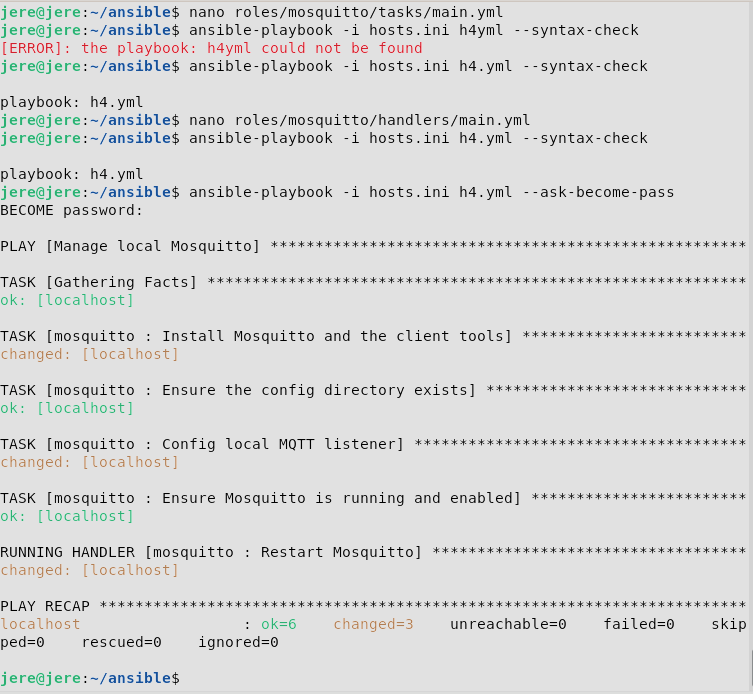

*Syntaksi oli ok.*

### Viestien testaus

Kirjoitin jälleen vasempaan terminaaliin:

```bash
mosquitto_sub -h 127.0.0.1 -p 1884 -t 'h4/pizza' -v -C 1
```

Oikeaan terminaaliin:

```bash
mosquitto_pub -h 127.0.0.1 -p 1884 -t 'h4/pizza' -m 'Ansible-asennuksen viestitesti'
```

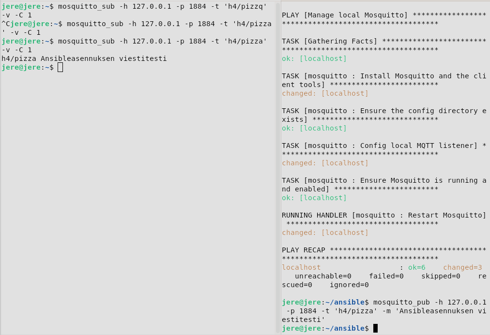

*Asennus Ansiblen kautta toimii.*

## c) Asetus

Muutin tiedostossa `~/ansible/roles/mosquitto/defaults/main.yml` arvoksi:

```yaml
mosquitto_port: 1885
```

Ajoin uudelleen:

```bash
ansible-playbook -i hosts.ini h4.yml --ask-become-pass
```

Sitten tarkistin asetustiedoston ja kuuntelevat portit:

```bash
cat /etc/mosquitto/conf.d/h4.conf
sudo ss -ltnp '( sport = :1883 or sport = :1884 or sport = :1885 )'
```

Muutokset näkyivät oikein.

Tarkistin muutosten toimivuuden vielä käytännössä. Vasemmassa terminaalissa:

```bash
mosquitto_sub -h 127.0.0.1 -p 1885 -t 'h4/pizza' -v -C 1
```

Oikeassa terminaalissa:

```bash
mosquitto_pub -h 127.0.0.1 -p 1885 -t 'h4/pizza' -m 'Portin vaihto onnistui: 1885'
```

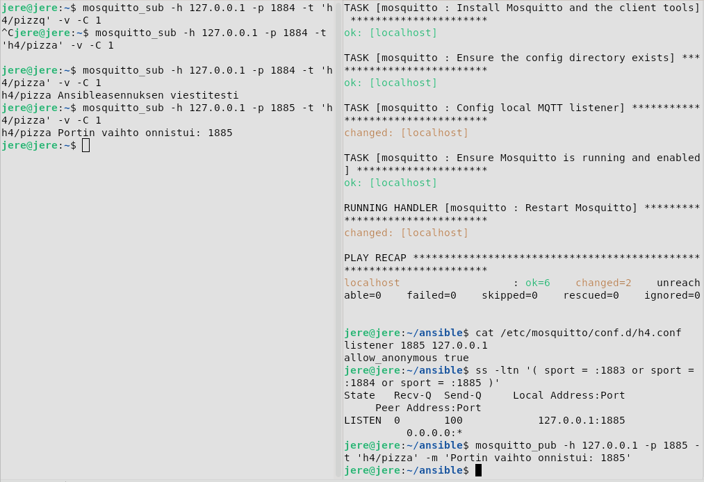

*Portin vaihto onnistui.*

## d) Paikat vaihtoon

Poistin ensin asennuksen komennolla:

```bash
sudo apt purge mosquitto
```

Tämän jälkeen testasin yhteyttä:

```bash
mosquitto_pub -h 127.0.0.1 -p 1885 -t 'h4/pizza' -m 'Rikotun palvelun testi'
```

Testasin asetustiedoston puuttumista:

```bash
test ! -e /etc/mosquitto/conf.d/h4.conf && echo "puuttuu"
```

Komento ei tulostanut mitään.

Seuraavaksi tarkistin vielä paketin asennuksen tilan`dpkg-query`-komennolla. Valinta `-W` näyttää paketin tiedot ja `-f` määrittää tulosteen muodon (Debian, dpkg-query(1)).:

```bash
dpkg-query -W -f='${binary:Package}: ${Status}\n' mosquitto
```

Sitten tarkistin asetustiedoston olemassaolon:

```bash
ls -l /etc/mosquitto/conf.d/h4.conf
```

Asetustiedosto oli vielä paikallaan, joten poistin sen:

```bash
sudo rm /etc/mosquitto/conf.d/h4.conf
```

Ajoin vielä:

```bash
test ! -e /etc/mosquitto/conf.d/h4.conf && echo "puuttuu"
```

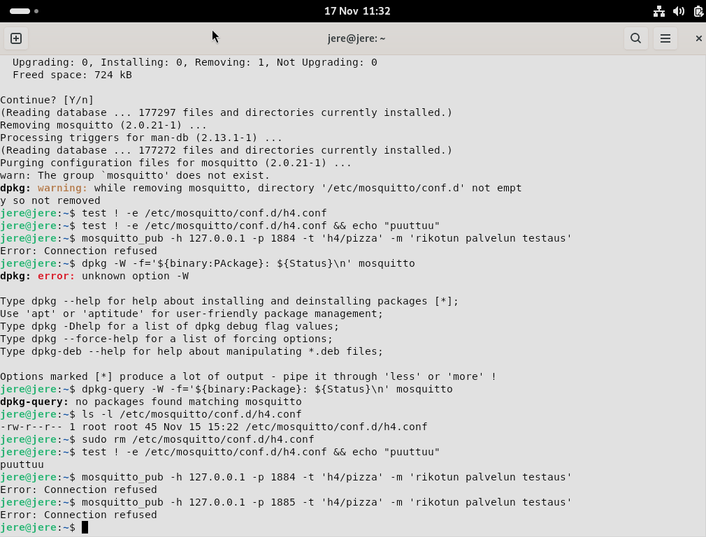

*Vaiheita poistosta.*

Menin kansioon `ansible` ja suoritin:

```bash
ansible-playbook -i hosts.ini h4.yml --ask-become-pass
```

**Sivuhuomio:** `ansible-playbook -i hosts.ini h4.yml -K` tekisi saman.

Testasin vielä, että Mosquitto toimii. Käytin ensin väärää porttia 1884. Korjasin asian, ja yhteys alkoi toimia.

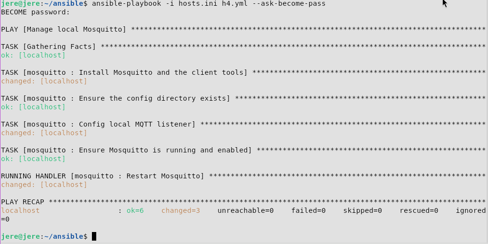

*Korjaus*

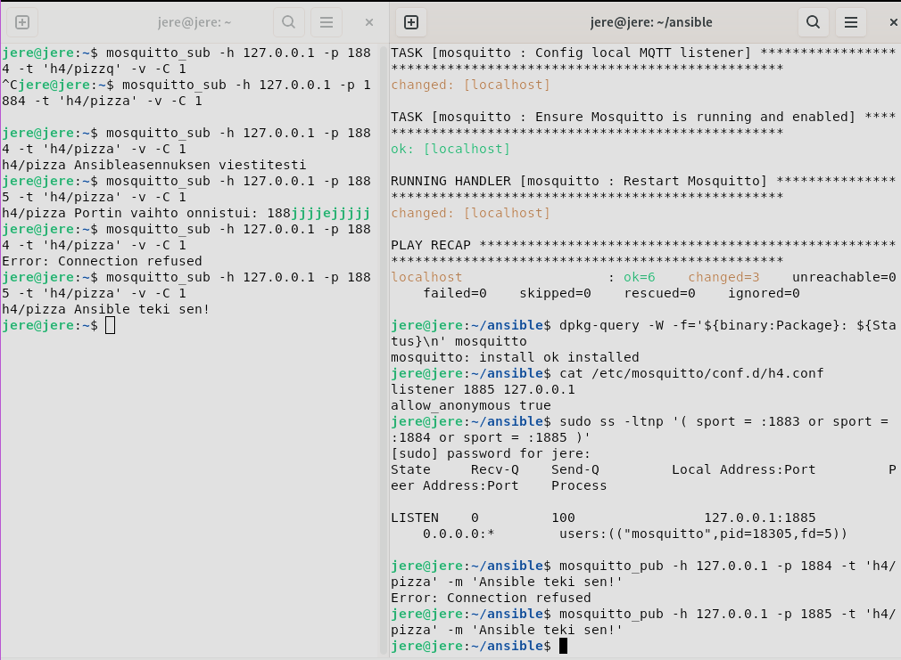

*Yhteyden testaus.*


## e) Idempotentti


Ajoin sitten seuraavat komennot:

```bash
systemctl show mosquitto -p MainPID -p ExecMainStartTimestamp
ansible-playbook -i hosts.ini h4.yml --ask-become-pass
systemctl show mosquitto -p MainPID -p ExecMainStartTimestamp
```

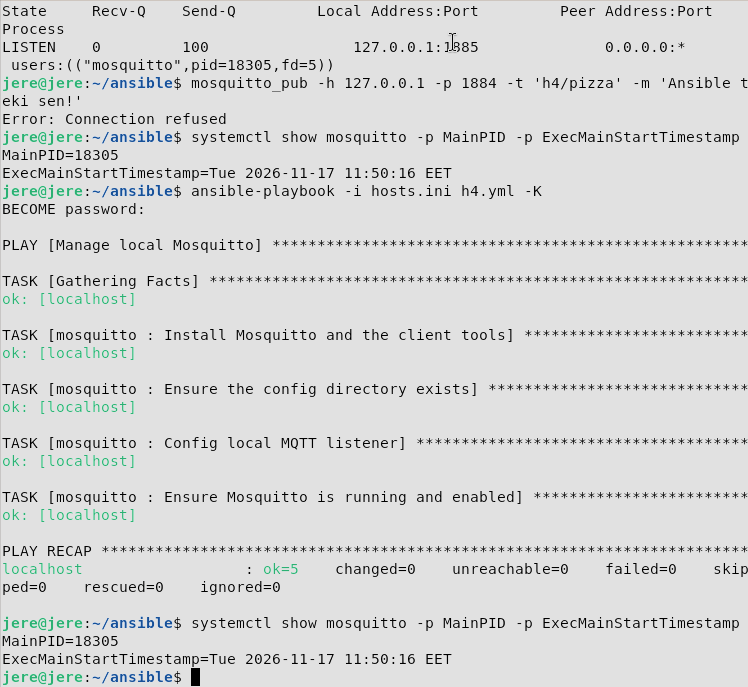

- Ansible: ok=5, changed=0, failed=0.
- Handleria ei suoritettu.
- MainPID=18305 ja käynnistysaika 17.11.2026 klo 11.50.16 EET pysyivät samoina.
- Viesti `rikotun palvelun testaus 2` 

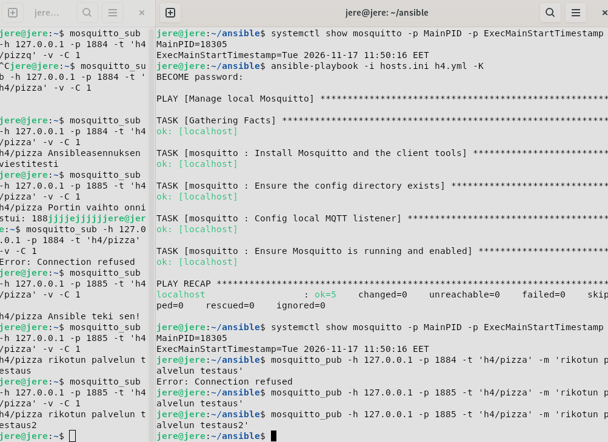

*Viimeinen testi*


## Loppupohdinta

Ansible on erittäin käytännöllinen. Jään tietenkin pohtimaan mihin kaikkeen Ansible venyy. Oli hienoa huomata, että poistettu demoni ja asetukset palautettii ilman käsin asentamista. 

Huomasin, että omat suurimmat virheeni ovat edelleen kirjoitusvirheitä. Tästä oppineena aion kiinnittää enemmän huomiota kirjoittamiseen enkä vain painaa Enteriä; Ainakin omalla kohdallani vianetsintä kannattaa aina aloittaa siitä. 

Oli myös hienoa nähdä idempotenssi käytännössä: uudelleenajossa tuloksena oli changed=0, ja palvelun käynnistysaika pysyi muuttumattomana. Ansible ei tehnyt tarpeettomia muutoksia eikä käynnistänyt palvelua uudelleen. 

Seuraavaksi haluaisin kokeilla tätä suuremmalla laitemäärällä.


## Lähteet

- **Karvinen, T. 2023.** [Configuration Management of Distributed Systems over Unreliable and Hostile Networks](https://terokarvinen.com/palvelinten-hallinta/Karvinen-2023-Configuration-Management-of-Distributed-Systems-over-Unreliable-and-Hostile-Networks.pdf). Kohdat 4.12.1, 4.12.2 ja 4.12.3.1, s. 112–117. Käytetty useana päivänä 13.–17.11.2026.

- **Karvinen, T. 2026.** [Palvelinten hallinta](https://terokarvinen.com/palvelinten-hallinta/). Tehtävän h4 Pizza Fantasia tehtävänanto ja ohjeet. Käytetty useana päivänä 13.–17.11.2026.

- **Eclipse Mosquitto / Debian.** [mosquitto.conf(5) – Debian 13 Trixie](https://manpages.debian.org/trixie/mosquitto/mosquitto.conf.5.en.html). `listener`- ja `allow_anonymous`-asetusten toiminta.

- **Eclipse Foundation.** [Eclipse Mosquitto](https://projects.eclipse.org/projects/iot.mosquitto). Mosquitton projektikuvaus. Viitattu 15.11.2026.

- **Eclipse Mosquitto.** [Documentation](https://mosquitto.org/documentation/). Mosquitton dokumentaatio. Käytetty useana päivänä 13.–17.11.2026.

- **Debian.** [dpkg-query(1) – Debian 13 ”Trixie”](https://manpages.debian.org/trixie/dpkg/dpkg-query.1.en.html). Pakettien tietojen ja asennustilan tarkistaminen sekä tulosteen muotoilu valinnoilla `-W` ja `-f`. Viitattu 17.11.2026.

- **Ansible Handler** [Ansible Handler documentation](https://docs.ansible.com/projects/ansible/latest/playbook_guide/playbooks_handlers.html). Käytetty useana päivänä 13.–17.11.2026.


## Tekoälyn käyttö

- **ChatGPT-6.0 (OpenAI), 17.11.2026.** Käytin ChatGPT:tä oman raporttitekstini Markdown-muotoiluun GitHubia varten sekä kirjoitusvirheiden korjaamiseen.
