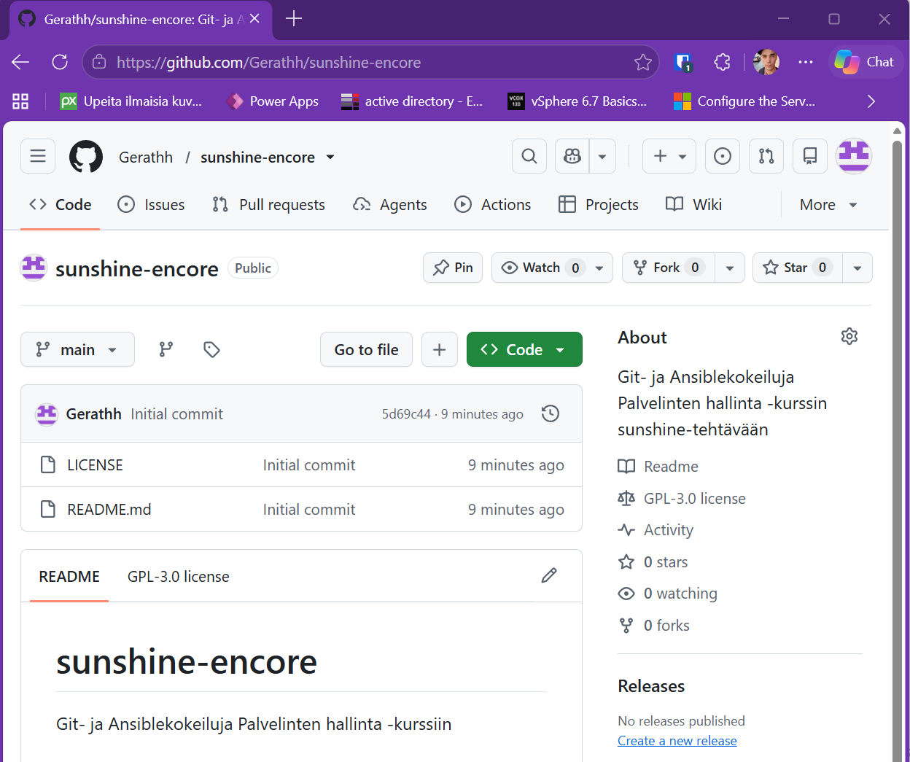
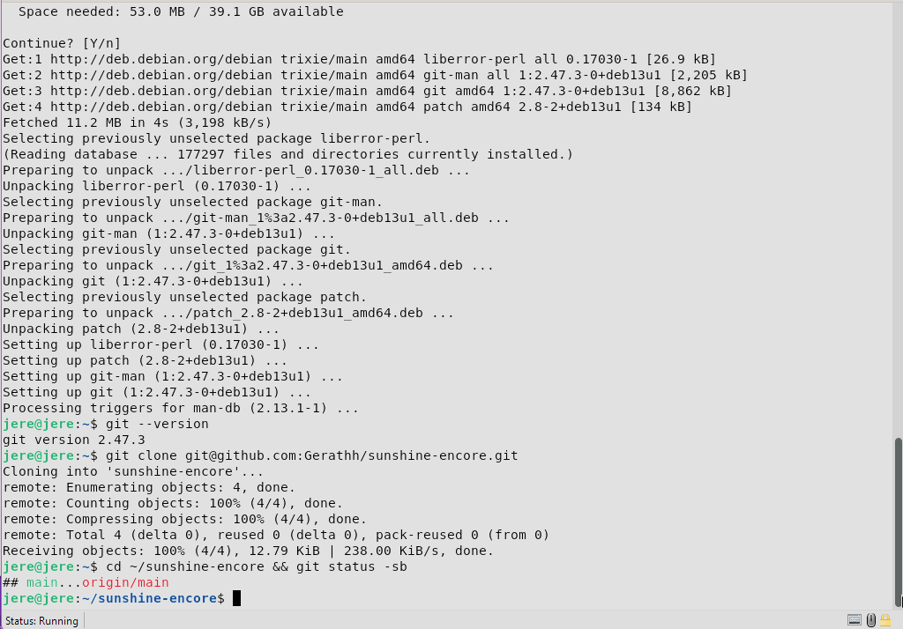
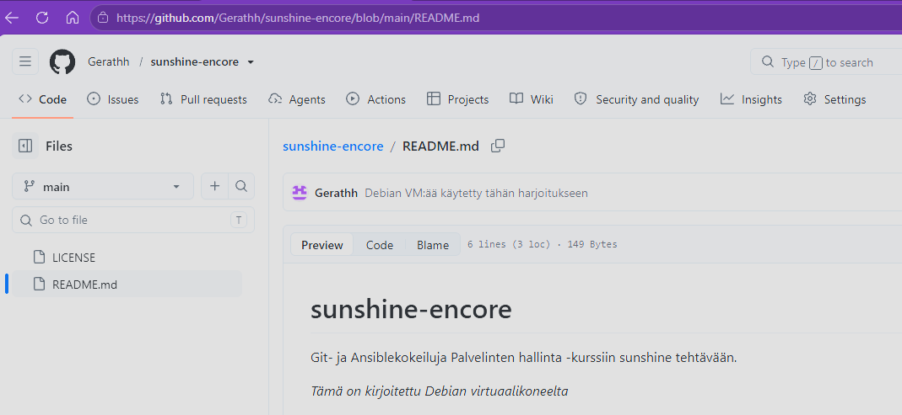
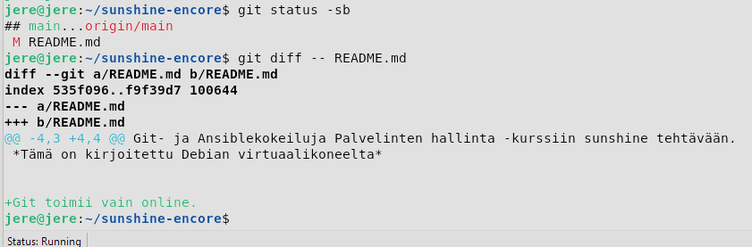
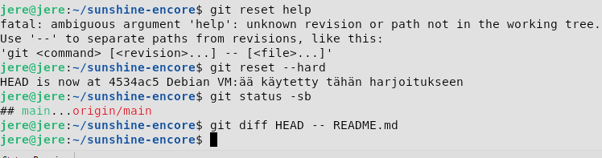
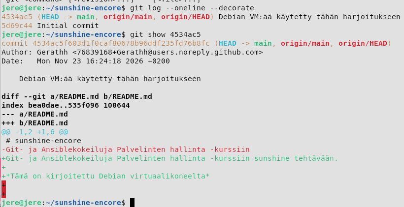
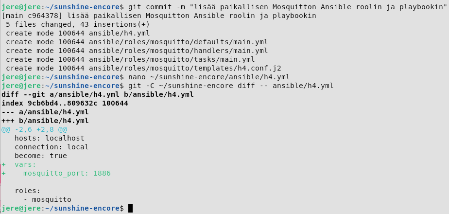
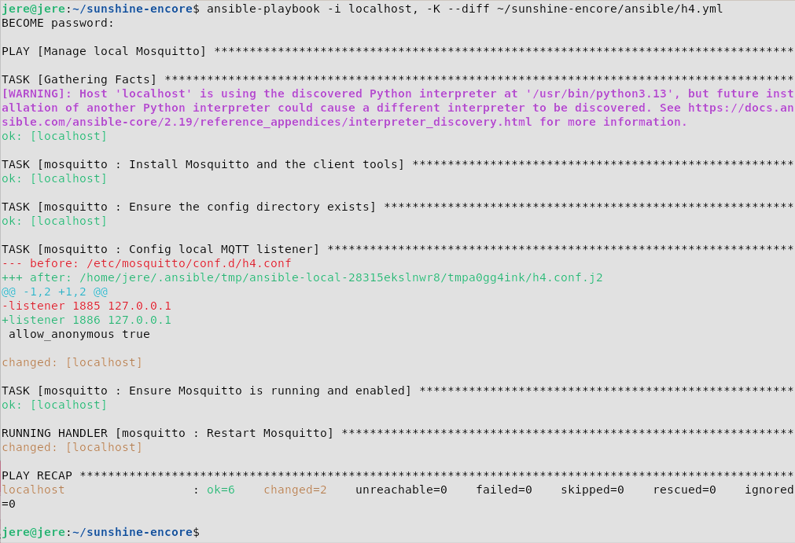
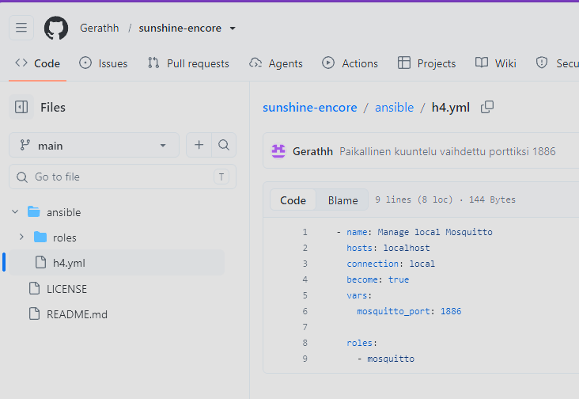

# h5 Gitar Hero

Jere Pellinen · 23.11.2026 · Palvelinten hallinta ICI001AS3A-3017 · Haaga-Helia · Tero Karvinen

Mulla oli käytössä Debian 13, joka pyöri Hyper-V:ssä Windows 11 -koneella. GitHub oli jo tuttu entuudestaan ja Gitiäkin olin käyttänyt PowerShellissä. Nyt tein koko harjoituksen Debianin Bashissa. [Oma sunshine-encore-varasto](https://github.com/Gerathh/sunshine-encore)

## x) Lue ja tiivistä

Luin Pro Gitin luvun 1.3. Tässä muutama juttu, jotka siitä jäi mieleen.

- Commit on vähän kuin kuva siitä, miltä projekti näytti juuri sillä hetkellä. Jos tiedosto pysyi samana, Git voi viitata sen aiemmin tallennettuun sisältöön.
- Kun kloonaan varaston, saan historian omalle koneelle. VOin siis tutkia vanhoja versioita ja tehdä committeja vaikka netti olisi poikki.
- Git laskee sisällöstä tiivisteen eli hashin. Jos sisältö muuttuu, myös sen tunniste muuttuu.
- Tiedostolla on pari pysäkkiä ennen kuin muutos on tallessa. Ensin muokkaan sitä työkansiossa, sitten valitsen muutoksen valmistelualueelle ja lopuksi teen commitin.

**Oma huomio.** Oli kiva tajuta, että Git yleensä vaan lisää dataa. Myös se jäi mieleen, miten Git käyttää hasheja. Kun historia on jo omalla koneella töitä pystyy tekemään myös offline. [Pro Git, luku 1.3](https://git-scm.com/book/en/v2/Getting-Started-What-is-Git%3F)

### Mitä tehtävän komentorivi tekee?

Tehtävässä nämä oli laitettu yhdelle riville. Itse ajoin komennot tässä harjoituksessa erikseen.

```bash
git add --all && git commit; git pull && git push
```

| Osa | Merkitys Debianin Bashissa |
|---|---|
| `git add` | Valitsen seuraavaan committiin tiedoston sellaisena kuin se on nyt. Jos muokkaan sitä , uusi muutos pitää lisätä uudestaan. |
| `--all` | Ottaa mukaan koko työpuun uudet tiedostot, muokkaukset ja poistot. Esimerkiksi Gitin ohittama uusi tiedosto jää pois. |
| `&&` | Bash jatkaa oikealla olevaan komentoon, jos edellinen onnistui eli palautti arvon 0. |
| `git commit` | Tallentaa valmistellut muutokset paikalliseen historiaan. Tässä Git avaa editorin, johon voin kirjoittaa commit-viestin. |
| `;` | Tästä alkaa uusi komentolista. Bash jatkaa siihen, vaikka äskeinen komento olisi antanut virheen. |
| `git pull` | Hakee etävaraston uusimmat muutokset ja sovittaa ne mun nykyiseen haaraan Gitin asetusten mukaan. |
| `git push` | Lähettää etävarastosta puuttuvan datan ja pyytää päivittämään siellä olevan haaran. |

Tuossa on oikeastaan kaksi paria. Jos add epäonnistuu, commit jää väliin. Puolipisteen takia Git yrittää silti pullia. Tämä käy myös silloin jos committiin ei ole mitään tallennettavaa. Jos pull onnistuu, push voi lähettää aiemmin tehtyjä committeja. Jos pull epäonnistuu, Bash jättää pushin väliin.  [Komentojen lähteet](#lähteet)

## a) Online

Tein GitHubiin tätä tehtävää varten uuden repon. Nimeksi tuli `sunshine-encore` ja About-kohtaan kirjoitin ”Git- ja Ansiblekokeiluja Palvelinten hallinta -kurssin sunshine-tehtävään”. Sunshine löytyy siis molemmista kuten tehtävänannossa pyydettiin. Otin mukaan README:n ja GPLv3-lisenssin.



*Kuva 1. Tässä näkyy uusi repo heti ensimmäisen commitin jälkeen. About-kohdasta löytyy sunshine.*

## b) Dolly

Kokeilin aluksi, tunnistaako GitHub mut Debianilta käsin. Ajoin `ssh -T git@github.com`. SSH kysyi ensin, hyväksynkö palvelimen avaimen. Hyväksyin sen ja avain tallentui `known_hosts`-tiedostoon. Heti perään tuli kuitenkin `Permission denied (publickey)`.

Avainta etsiessä multa jäi piste pois polusta `~/.ssh`. Kirjoitin siis `~/ssh`. Lainausmerkkikin jäi auki, joten Bash jäi odottamaan lisää tekstiä ja näytti rivin alussa merkin `>`. Lopulta `ls ~/.ssh` näytti tiedoston `id_ed25519.pub`. Lisäsin sen julkisen avaimen GitHubiin ja kokeilin SSH-yhteyttä uudestaan. Tällä kertaa vastassa oli `Hi Gerathh!`.

Seuraava yllätys tuli kloonatessa. Debian vastasi `command not found`, eli Git piti vielä asentaa paketinhallinnasta. Asennuksen jälkeen tarkistin version ja hain varaston omalle koneelle.

```bash
git --version
git clone git@github.com:Gerathh/sunshine-encore.git
cd ~/sunshine-encore && git status -sb
```



*Kuva 2. Git oli nyt versiossa 2.47.3. Kloonauksen jälkeen status näytti vain rivin `## main...origin/main`.*

Kun kysyin Gitiltä nimeä ja sähköpostia, molemmat näytti tyhjää. Kokeilin `git config local user.name "Gerathh"` ja sain vastaukseksi `key does not contain a section: local`. Minulta puuttui kaksi viivaa sanan `local` edestä. Ennen committia vaihdoin sähköpostiksi GitHubin asetuksista löytyneen noreply-osoitteen.

```bash
nano README.md
git diff -- README.md
git add README.md
git status -sb
git commit -m "Debian VM:ää käytetty tähän harjoitukseen"
git push
```

Muokkasin README:n kuvausta ja kirjoitin kursiivilla ”Tämä on kirjoitettu Debian virtuaalikoneelta”. Diffi näytti myös loppuun jääneet tyhjät rivit. Commitiksi tuli `4534ac5`. Pushin jälkeen avasin README:n selaimessa. Siellähän se sama rivi näkyi GitHubissakin. Edellinen versio oli `5d69c44`.



*Kuva 3. Sama Debianilla kirjoitettu rivi näkyy nyt kursiivilla GitHubissa.*

## c) Doh!

Katsoin ensin komennolla `git status -sb`, että työkansio oli puhdas. Sitten kirjoitin README:hen tahallani ”Git toimii vain online.” Jätin muutoksen työkansioon ja katsoin statuksesta ja diffistä, mitä olin kohta heittämässä pois.



*Kuva 4. Tässä näkyy koko tahallinen moka yhdellä rivillä.*

Yritin vilkaista ohjetta komennolla `git reset help`. Git ihmetteli sanaa `help`. Sanat olisivat menneet oikein järjestyksessä `git help reset`. Kun olin tarkistanut, että README:n testirivi oli ainoa keskeneräinen muutos, ajoin nämä komennot.

```bash
git reset --hard
git status -sb
git diff HEAD -- README.md
```



*Kuva 5. Resetin jälkeen HEAD oli taas kohdassa 4534ac5 ja README:n diff näytti tyhjää.*

Tämän kanssa saa olla tarkkana. Tässä `reset --hard` palautti sekä valmistelualueen että seuratut tiedostot nykyisen commitin tilaan. Jos mulla olisi ollut toisessa seuratussa tiedostossa jotain keskeneräistä, sekin olisi voinut kadota. Uudet, vielä seuraamattomat tiedostot jäävät yleensä paikalleen. Git voi silti poistaa sellaisenkin, jos se on palautettavan tiedoston tiellä. [Gitin reset-ohje](https://git-scm.com/docs/git-reset)

## d) Tukki

```bash
git log --oneline --decorate
git show 4534ac5
```

Tässäkin kokeilin ensin `git log help`, ja Git antoi siitä virheen. Yhden rivin lokista näkyi sitten mukavasti koko senhetkinen historia. Ensin olin luonut varaston ja sitten muokannut README:tä. `HEAD -> main` kertoi, että olin main-haarassa. Myös `origin/main`, eli mun koneen viimeisin tieto GitHubin main-haarasta, osoitti samaan committiin.



*Kuva 6. Ylhäällä on lyhyt loki. Sen alta näkee, mitä tuolla yhdellä commitilla oikeasti muutin.*

Poimin lokista tunnisteen `4534ac5` ja annoin sen komennolle `git show`. Tekijänä näkyi `Gerathh`, osoitteena GitHubin noreply ja aikana 23.11.2026 klo 16.24.18 (+0200). Alempana näkyi viesti ja sen alla README:n muutos rivi riviltä. Jos myöhemmin miettisin, milloin joku tietty muutos tuli mukaan, lähtisin samalla tavalla lokista liikkeelle.

## e) Gitanbile

Aiemmat Ansible-tehtävät oli jo tällä virtuaalikoneella.

```bash
find ~ -maxdepth 5 -type f -iname '*.y*ml'
git -C ~/ansible rev-parse --show-toplevel
```

Löysin `site.yml`- ja `h4.yml`-playbookit sekä nipun rooleja. Git vastasi `not a git repository`. Päätin ottaa mukaan h4:ssä tekemäni Mosquitto-harjoituksen. Sitä etsiessä kirjoitin vahingossa `{site.h4}`, ja grep etsi juuri tuon nimistä tiedostoa. Komennolla `cat ~/ansible/h4.yml` näin lopulta, että playbook ajoi pelkän Mosquitto-roolin paikallisesti korotetuilla oikeuksilla.

Rooli asentaa Mosquiton ja sen asiakasohjelmat sekä tekee asetuskansion. Varsinainen `/etc/mosquitto/conf.d/h4.conf` syntyy Jinja-pohjasta. Siinä osoite oli valmiiksi `127.0.0.1`, mutta portti tuli muuttujasta `mosquitto_port`. Sen oletus oli `1885`.

```bash
systemctl is-active mosquitto
ss -ltn '( sport = :1885 or sport = :1886 )'
```

Mosquitto vastasi `active`. Portteja katsoessa näkyi yksi LISTEN-rivi, `127.0.0.1:1885`. Päätin kokeilla, saisinko saman palvelun kuuntelemaan porttia 1886 pelkällä playbookin muutoksella.

Tarvitsin sunshine-varastoon viisi tiedostoa eli playbookin ja neljä roolin tiedostoa. Ensimmäinen kopiointiyritys kaatui siihen, että olin jo kohdekansiossa `~/sunshine-encore`. Siellähän ei ollut vielä edes lähteeksi antamaani `h4.yml`-tiedostoa. Vaihdoin kansioon `~/ansible`, tarkistin sijainnin ja kokeilin uudestaan.

```bash
cd ~/ansible && pwd
mkdir -p ~/sunshine-encore/ansible
cp -v --parents h4.yml roles/mosquitto/{tasks,defaults,handlers}/main.yml roles/mosquitto/templates/h4.conf.j2 ~/sunshine-encore/ansible/
git -C ~/sunshine-encore status --short --untracked-files=all
```

Nyt status näytti kaikki viisi uutta tiedostoa. `--parents` toi roolin kansiorakenteen mukana, joten tiedostot meni oikeille paikoilleen. Kävin vielä valmistellun diffin läpi. Halusin varmistaa että siellä ei näkynyt yksityisiä avaimia tai osoitteita.

```bash
cd ~/sunshine-encore
git add -- ansible/
git diff --cached --stat
git diff --cached
git commit -m "lisää paikallisen Mosquitton Ansible roolin ja playbookin"
```

Ekassa Mosquitto-commitissa `c964378` oli viisi tiedostoa ja 43 uutta riviä. Nyt mulla oli Gitissä versio, johon verrata portin vaihtoa. Avasin kopion komennolla `nano ~/sunshine-encore/ansible/h4.yml` ja lisäsin sinne nämä kaksi riviä.

```yaml
  vars:
    mosquitto_port: 1886
```



*Kuva 7. Nämä kaksi vihreää riviä lisäsin playbookiin. Roolin oma oletusportti oli edelleen 1885.*

```bash
ansible-playbook -i localhost, --syntax-check ~/sunshine-encore/ansible/h4.yml
ansible-playbook -i localhost, -K --diff ~/sunshine-encore/ansible/h4.yml
```

Syntaksitarkistus meni läpi ja tulosti playbookin polun. Varsinaisessa ajossa `-K` kysyi sudo-salasanan. Valitsimella `--diff` näin suoraan, kun asetustiedoston 1885 vaihtui porttiin 1886. Python-tulkista tuli varoitus. Ansible oli itse valinnut tulkin `/usr/bin/python3.13`, ja ajo jatkui sillä loppuun. Lopuksi `Restart Mosquitto` käynnisti palvelun uudestaan.



*Kuva 8. Asetus vaihtui ja palvelu käynnistyi uudestaan. Siitä tuli changed=2.*

Ajoin saman `ss`-komennon uudestaan. Tällä kertaa LISTEN-rivillä luki `127.0.0.1:1886`. Nyt portin vaihto näkyi myös Debianissa, joten tein siitä oman commitin.

```bash
git add -- ansible/h4.yml
git commit -m "Paikallinen kuuntelu vaihdettu porttiksi 1886"
git log -2 --oneline
git push origin main
```

Lokissa näkyi nyt peräkkäin lähtöversio `c964378` ja sen päälle tehty porttimuutos `ae782a4`. Pushin jälkeen kävin vielä selaimella katsomassa, mitä GitHubiin päätyi. [Playbook GitHubissa](https://github.com/Gerathh/sunshine-encore/blob/ae782a4/ansible/h4.yml)



*Kuva 9. Rivillä 6 on sama 1886, jonka näin Debianilla.*

## f) Projektipari

Projektipari on löytynyt [päivitetty 25.11.2026 klo 12:07]

## Loppupohdinta

Gitin syntaksi ei loppujen lopuksi vaikuttanut kovin vaikealta. Hasheista jäi mieleen se, että seitsemällä merkillä sain oman README-muutoksen esiin rivi riviltä. Mosquiton kanssa taas tuli käytännössä nähtyä, mitä paikallinen historia tarkoittaa. Tein omalla koneella ensin commitin toimivasta lähtöversiosta ja toisen portin vaihdosta. Vasta sitten lähetin molemmat GitHubiin samalla pushilla.

## Lähteet

Luin lähteet 23.11.2026. Komentojen selityksiin katsoin apua ohjeista. Käytännön tulokset on mun omalta koneelta.

- Tero Karvinen. [Palvelinten hallinta, h5 Gitar Hero](https://terokarvinen.com/palvelinten-hallinta/#h5-gitar-hero).
- Scott Chacon ja Ben Straub (2014). [Pro Git, 2. painos, luku 1.3 - 2.0: What is Git?](https://git-scm.com/book/en/v2/Getting-Started-What-is-Git%3F).
- Git. Komentojen käsikirjat: [git add](https://git-scm.com/docs/git-add), [git commit](https://git-scm.com/docs/git-commit), [git pull](https://git-scm.com/docs/git-pull), [git push](https://git-scm.com/docs/git-push) ja [git reset](https://git-scm.com/docs/git-reset).
- GNU. [Bash-käsikirja, Lists of Commands](https://www.gnu.org/software/bash/manual/html_node/Lists.html) ja [Findutils-käsikirja](https://www.gnu.org/software/findutils/manual/html_mono/find.html).

## Tekoälyn käyttö

- **ChatGPT-6.0 (OpenAI), 23.11.2026.** Käytin ChatGPT:tä oman raporttitekstini Markdown viimeistelyyn sekä kirjoitusvirheiden korjaamiseen.
